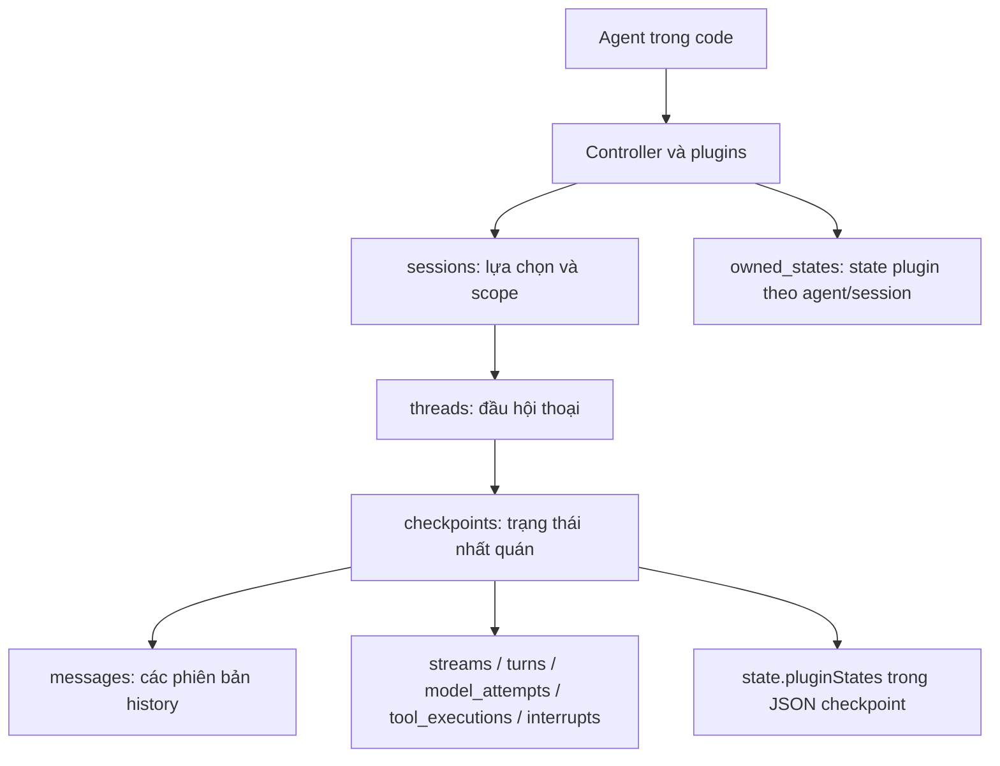

# Tessar lưu gì trong SQLite?

Tài liệu phản ánh schema v2 trong checkout hiện tại. Core định nghĩa state và vòng đời; `@tessar/sqlite` chỉ chọn nơi và cách lưu bền vững. **Không có bảng Agent.** Dev dựng `new Agent(...)` trong code; `sessions.agent_id` chỉ lưu định danh để kiểm tra khi khôi phục.

## 1. Toàn cảnh



| Đối tượng | Nơi lưu | Ý nghĩa |
| --- | --- | --- |
| Agent | Code ứng dụng | ID, instructions mặc định, model adapter, tool executors; không serialize class vào DB |
| Controller | RAM | Quản lý plugin và tài nguyên dùng chung; ID Controller không phải khóa để resume |
| Session | `sessions` và runtime handle | ID tự sinh, scope, Agent ID, model/thread đang chọn, metadata; queue/subscribers vẫn trong RAM |
| Thread | `threads` và checkpoint/history | Hội thoại độc lập; nhiều Session có thể chọn cùng thread |
| Stream | `streams` | Một lần thực thi input qua agent loop; có thể chứa nhiều turn |
| Turn | `turns` | Một vòng model/tool của loop; nhiều model attempt nếu retry |
| Model attempt | `model_attempts` | Một lần gọi adapter primary/auxiliary; usage, cache tokens, reasoning tokens nếu provider trả |
| Checkpoint | `checkpoints` cùng các version rows | Điểm khôi phục state/execution và fork an toàn |

## 2. Các bảng vật lý

| Bảng | Cột chính | Khóa/index và trách nhiệm |
| --- | --- | --- |
| `sessions` | `id, agent_id, selected_thread_id, revision, created_at, updated_at, body` | PK id; index `(agent_id, created_at, id)` và selected thread; FK selected thread, không có FK Agent |
| `threads` | `id, body, created_at, deleted` | PK id; index `(deleted, created_at, id)`; body chứa scope, metadata/title, head checkpoint, active stream và lineage |
| `checkpoints` | `id, thread_id, revision, created_at, cause, message_count, forkable, unsafe_reason, body` | PK id; unique `(thread_id,revision)`; page index `(thread_id,created_at,id)` |
| `messages` | Các cột version bên dưới | Toàn bộ history theo revision; index thêm `(thread_id,position,from_revision)` |
| `streams` | Các cột version | Execution status, output IDs, direct/inclusive usage |
| `turns` | Các cột version | Turn index, assistant ID, usage, thời gian, kết quả |
| `model_attempts` | Các cột version | Model/provider, request ID, usage/cache, purpose, lỗi, thời gian |
| `tool_executions` | Các cột version | Tool call ID, arguments, policy, kết quả, lỗi, idempotency |
| `interrupts` | Các cột version | Pending/resolved/cancelled, payload, response, handler/action binding |
| `staging` | `id, body, fingerprint` | Batch chưa publish; không nhìn thấy qua history |
| `commits` | `id, body, fingerprint, thread_id` | Receipt và hash SHA-256 để retry idempotent; index thread |
| `leases` | `thread_id, owner_token, fencing_token, expires_at` | Quyền ghi, chống hai owner cùng publish; thời hạn theo clock SQLite |
| `owned_states` | `owner_key, revision, body` | Plugin state độc lập theo Agent/Session, cập nhật CAS |

Sáu bảng version (`messages` và năm bảng trace) có:

```text
thread_id, id, from_revision, to_revision, position,
stream_id, turn_id, status, sort_date, body
```

PK là `(thread_id,id,from_revision)`. Unique index `(thread_id,id) WHERE to_revision IS NULL` bảo đảm chỉ có một phiên bản hiện tại. Index page/stream/turn hỗ trợ truy vấn theo parent và thứ tự ngày/ID. `position` chỉ dùng cho messages; các cột parent không áp dụng thì là NULL.

Một row hiện diện tại revision R khi:

```sql
from_revision <= R AND (to_revision IS NULL OR R < to_revision)
```

Chỉ message/record đổi nội dung hoặc vị trí mới tạo version mới. Rename thread không sao chép history. Checkpoint JSON vẫn chứa scope, metadata, instructions, pluginStates và execution nhưng **không chứa mảng messages**. `checkpoints.get()` dựng lại public `Checkpoint.state.messages` từ version rows.

Không còn bảng `plugin_states`; state plugin theo thread/stream/turn nằm trong `checkpoint.state.pluginStates`.

## 3. Session và restart

```ts
const session = await controller.createSession({
  scope: { userId: "u1" },
  metadata: { label: "work" },
});
await session.thread.create({ title: "Conversation" });
const sessionId = session.id;

// Process sau: dựng Agent/providers/plugins, rồi initialize Controller.
const restored = await controller.getSession(sessionId, {
  scope: { userId: "u1" },
});
if (restored) {
  const history = await restored.thread.getHistory({ limit: 50 });
  restored.subscribe(event => render(event));
  await restored.followUp(new HumanMessage("Tiếp tục"));
}
```

`getSession` trả null khi không tồn tại hoặc không khớp scope; sai Agent ID báo `SessionAgentMismatch`. Scope bất biến, là bộ lọc state do ứng dụng cung cấp, không thay thế authentication/authorization.

`setModel`, `thread.create`, `thread.switch` lưu selection trước khi báo thành công. Revision CAS từ chối handle cũ bằng `CommitConflict`; gọi lại `getSession` để có handle mới. Nếu tạo thread thành công nhưng lưu selection thất bại, thread vẫn có trong danh sách scoped, lựa chọn của Session chưa đổi. `dispose` chỉ đóng handle; không xóa record.

`listSessions({ scope, limit, cursor })` chỉ liệt kê Session của Agent trên Controller hiện tại. Hai Session cùng scope vẫn có hai ID độc lập. Thread không có parent Session bắt buộc; list thread dựa trên scope.

Model selection lưu ref, request options và descriptor kết nối không chứa API key/header. Với OpenAI, cấu hình `connectionId` ổn định để khôi phục native history. Cùng ID nhưng endpoint/protocol khác bị từ chối. Execution checkpoint giữ `modelConnection` và kiểm tra trước resume/recover, kể cả chạy trực tiếp qua Thread và chưa có assistant history. ID ngẫu nhiên mặc định không tự nối lại qua process mới. Legacy binding phải được host xác minh và khai báo lại ID cũ rõ ràng.

Khôi phục Session chỉ khôi phục handle và selection; không tự gửi input, chạy job, resume hoặc recover. Queue followUp chưa được admission và subscribers không được lưu.

## 4. History, context gửi model và state plugin

- UI đọc `session.thread.getHistory()` hoặc `thread.getHistory()`. Trang mặc định tối đa 50 message, có cursor để lấy phần trước; một cursor giữ cố định checkpoint dù có message mới.
- Agent loop đọc checkpoint đầy đủ rồi dựng request qua ContextAssembler và `context.prepare`. Model không đọc trực tiếp bảng SQL.
- Plugin có thể đọc history, chọn prefix đã summary và thay request context. Summary cùng con trỏ do plugin lưu qua state/checkpoint; core không tự compact hoặc tự cắt history.
- `state.pluginStates` là mảng `{pluginId, namespace, ownerType, ownerId, schemaVersion, revision, data}`. Owner thread/stream/turn đi cùng checkpoint và phục hồi chung với execution.
- `context.state.owned({type:"session",id:context.session.id})` dùng `owned_states`, có revision CAS riêng. Owner `agent` là định danh ứng dụng; không cần một bảng Agent.
- Plugin background/scheduler cần index deadline, claim job hay query riêng thì tự sở hữu storage và migration. Core không có bảng background task hoặc raw SQL API. Có thể dùng DB riêng; nếu tự mở cùng file SQLite phải quản lý bảng riêng, không sửa bảng Tessar hoặc `PRAGMA user_version`.

Usage nằm ở model attempt và được tổng hợp lên turn/stream. Provider có thể chỉ trả một phần: `null` biểu thị không biết; không biến thành 0. Cache usage là số token provider báo, không phải phép đo số token của từng đoạn history. Reasoning/providerState được giữ trong message; adapter quyết định encode sang native protocol.

## 5. Publish, fork, delete và migration

Publish kiểm tra lease đúng thread, owner/fence còn hiệu lực và expected revision. Trong một transaction: ghi versions, checkpoint, thread head, receipt/fingerprint rồi xóa batch staging. Lỗi rollback không để lộ nửa trạng thái. Batch chưa publish vẫn còn để chẩn đoán/retry. Retry cùng commit ID và cùng payload trả receipt; cùng ID khác payload bị từ chối, kể cả staging đã dọn.

`deleteThread` là soft delete: ẩn thread khỏi các query bình thường và xóa lựa chọn tương ứng ở tất cả Session trong cùng transaction, tăng Session revision. Handle cũ không được dùng tiếp như thể chưa có thay đổi.

`purgeThread` chỉ xóa vĩnh viễn thread đã soft-delete, không có execution/lease đang hoạt động, không còn fork nào tham chiếu (kể cả fork đã soft-delete). Nó gọi policy `thread.beforeDelete` với `permanent:true`, xóa snapshots/versions/staging/receipts/lease và head trong transaction; không xóa bảng plugin khác. Publish một fork cũng kiểm tra nguồn/checkpoint vẫn tồn tại trong transaction, tránh race với purge. Xóa fork đủ điều kiện trước rồi mới xóa nguồn. Không có tác vụ tự dọn nền.

Schema v1 → v2 migrate trong `BEGIN IMMEDIATE`, đọc lại version sau khi lấy lock. Giữ ID/checkpoint logic, providerState, plugin state, trace lịch sử, fork lineage, leases, owned state, receipts và batch chưa publish. Không tự tạo Session cho thread cũ. Nonempty legacy plugin_states, receipt thiếu staged payload, JSON lỗi hoặc SQL failure làm rollback toàn bộ; không bỏ dữ liệu để cố migrate.

Pagination dùng SQL LIMIT/keyset và BINARY ordering; memory backend dùng UTF-8 ordinal tương ứng. Scope keys/values được bind, kể cả dấu chấm, dấu nháy và Unicode; boolean/number/string không lẫn nhau. Scope JSON tùy ý có thể phải scan candidate rows, không có index cho mọi key.

## 6. Thời gian và giới hạn

Model attempt dùng monotonic timer cho `durationMs` và `timeToFirstOutputMs`; không có delta quan sát được thì first-output là null. Auxiliary response chỉ có `responseMessageId` nếu có message đã thực sự persist; hiện auxiliary không tự thêm message vào history nên field này là null.

Stream cộng các đoạn chạy đang được quan sát và loại thời gian chờ suspend. Checkpoint giữ `execution.timing = {completedActiveMs, segmentOpen, complete}`. Đoạn còn mở sau crash hoặc checkpoint legacy thiếu timing làm tổng duration null; không bịa thời lượng bị mất. Turn hoàn tất trong một attachment đo monotonic; turn kéo dài qua reattachment giữ null. Các timestamp lịch sử vẫn là UTC ISO.

SQLite dùng synchronous I/O trên Node, chưa có tuyên bố throughput cho backend nhiều người dùng. Public checkpoint đầy đủ và state plugin vẫn có thể lớn; tối ưu version rows không xóa mọi chi phí copy trong RAM.

## 7. Dữ liệu thực tế từ fixture

Nguồn: `tests/integration/persistence-restart.test.ts`, kịch bản tool → suspend → đóng DB → mở lại → resume. SQLite thật, model ScriptedProvider giả lập, không gọi API bên ngoài. UUID và timestamp dưới đây giữ nguyên từ fixture; không phải ID bắt buộc hoặc giá trị hardcode của Tessar. Một số bảng chỉ hiển thị hai row đại diện; trace/messages là version hiện tại. `body` đã parse từ JSON TEXT để đọc được.

Sinh lại sample bằng biến `TESSAR_SAMPLE_PATH` trỏ tới file JSON khi chạy test này. Đây là dữ liệu kiểm thử trong thư mục tạm, không phải DB của người dùng.

| Bảng | Số row vật lý trong fixture |
| --- | ---: |
| `sessions` | 1 |
| `threads` | 1 |
| `checkpoints` | 21 |
| `messages` | 4 |
| `streams` | 9 |
| `turns` | 9 |
| `model_attempts` | 4 |
| `tool_executions` | 5 |
| `interrupts` | 2 |
| `staging` | 0 |
| `commits` | 21 |
| `leases` | 1 |
| `owned_states` | 1 |

Các row trace lịch sử khác revision không phải lần gọi model/tool mới. Không cộng toàn bộ versions để tính số lần execution.

### `sessions`

```json
[
  {
    "id": "session_a835554b-478d-489a-9b6c-5cbe18360664",
    "agent_id": "test-agent",
    "selected_thread_id": "thread_9eeae17c-6fe3-4037-8faf-5c4355f6b099",
    "revision": 2,
    "created_at": "2026-10-19T07:23:59.077Z",
    "updated_at": "2026-10-19T07:23:59.081Z",
    "body": {
      "agentId": "test-agent",
      "createdAt": "2026-10-19T07:23:59.077Z",
      "id": "session_a835554b-478d-489a-9b6c-5cbe18360664",
      "metadata": {},
      "revision": 2,
      "scope": {},
      "selectedModel": {
        "ref": {
          "modelId": "test",
          "providerId": "scripted"
        }
      },
      "selectedThreadId": "thread_9eeae17c-6fe3-4037-8faf-5c4355f6b099",
      "updatedAt": "2026-10-19T07:23:59.081Z"
    }
  }
]
```

### `threads`

```json
[
  {
    "id": "thread_9eeae17c-6fe3-4037-8faf-5c4355f6b099",
    "body": {
      "activeStreamId": null,
      "createdAt": "2026-10-19T07:23:59.078Z",
      "currentCheckpointId": "checkpoint_44870c89-bc52-4c4e-b1b0-17139ac3ebf1",
      "deleted": false,
      "id": "thread_9eeae17c-6fe3-4037-8faf-5c4355f6b099",
      "metadata": {},
      "parentThreadId": null,
      "revision": 21,
      "scope": {},
      "sourceCheckpointId": null,
      "updatedAt": "2026-10-19T07:23:59.175Z"
    },
    "created_at": "2026-10-19T07:23:59.078Z",
    "deleted": 0
  }
]
```

### `checkpoints`

```json
[
  {
    "id": "checkpoint_08dfab13-a118-49bc-a25b-1dfa11d53aae",
    "thread_id": "thread_9eeae17c-6fe3-4037-8faf-5c4355f6b099",
    "revision": 1,
    "created_at": "2026-10-19T07:23:59.078Z",
    "cause": "ThreadCreated",
    "message_count": 0,
    "forkable": 1,
    "unsafe_reason": null,
    "body": {
      "cause": "ThreadCreated",
      "createdAt": "2026-10-19T07:23:59.078Z",
      "execution": null,
      "id": "checkpoint_08dfab13-a118-49bc-a25b-1dfa11d53aae",
      "parentCheckpointId": null,
      "revision": 1,
      "schemaVersion": 1,
      "state": {
        "instructions": null,
        "metadata": {},
        "pluginStates": [],
        "scope": {}
      },
      "threadId": "thread_9eeae17c-6fe3-4037-8faf-5c4355f6b099"
    }
  },
  {
    "id": "checkpoint_ce4272f7-9d55-4200-8a0b-3a4f5ca8df5e",
    "thread_id": "thread_9eeae17c-6fe3-4037-8faf-5c4355f6b099",
    "revision": 2,
    "created_at": "2026-10-19T07:23:59.083Z",
    "cause": "InputCommitted",
    "message_count": 1,
    "forkable": 1,
    "unsafe_reason": null,
    "body": {
      "cause": "InputCommitted",
      "createdAt": "2026-10-19T07:23:59.083Z",
      "execution": {
        "baseInstructions": {
          "sections": [
            {
              "content": "",
              "id": "default"
            }
          ]
        },
        "budgets": {
          "limits": {
            "maxModelAttempts": 64,
            "maxToolCalls": 128,
            "maxTurns": 32
          },
          "modelAttempts": 0,
          "toolCalls": 0,
          "turns": 0
        },
        "handlerCursor": null,
        "modelRef": {
          "modelId": "test",
          "providerId": "scripted"
        },
        "pendingInterruptId": null,
        "pendingToolExecutionIds": [],
        "phase": "BeforeTurn",
        "recordRevision": 2,
        "registryManifest": [
          {
            "configurationId": null,
            "id": "primary",
            "kind": "storage",
            "pluginId": "test-storage",
            "pluginVersion": 1,
            "requiredForContinuation": true,
            "version": 1
          },
          {
            "configurationId": null,
            "id": "scripted",
            "kind": "provider",
            "pluginId": "scripted",
            "pluginVersion": 1,
            "requiredForContinuation": true,
            "version": 1
          },
          {
            "configurationId": "v1",
            "id": "summary:context",
            "kind": "state",
            "pluginId": "summary",
            "pluginVersion": 1,
            "requiredForContinuation": true,
            "version": 1
          },
          {
            "configurationId": "v1",
            "id": "work",
            "kind": "tool",
            "pluginId": "summary",
            "pluginVersion": 1,
            "requiredForContinuation": true,
            "version": 1
          },
          {
            "configurationId": "v1",
            "id": "continue",
            "kind": "interruption",
            "pluginId": "summary",
            "pluginVersion": 1,
            "requiredForContinuation": true,
            "version": 1
          },
          {
            "configurationId": "v1",
            "id": "summary:turn.decision:0",
            "kind": "handler",
            "pluginId": "summary",
            "pluginVersion": 1,
            "requiredForContinuation": true,
            "version": 1
          }
        ],
        "streamId": "stream_3e2ca9b9-0b04-4fda-82e3-78d5e23e165d",
        "timing": {
          "complete": true,
          "completedActiveMs": 0.22469999999998436,
          "segmentOpen": true
        },
        "turnId": null
      },
      "id": "checkpoint_ce4272f7-9d55-4200-8a0b-3a4f5ca8df5e",
      "parentCheckpointId": "checkpoint_08dfab13-a118-49bc-a25b-1dfa11d53aae",
      "revision": 2,
      "schemaVersion": 1,
      "state": {
        "instructions": null,
        "metadata": {},
        "pluginStates": [],
        "scope": {}
      },
      "threadId": "thread_9eeae17c-6fe3-4037-8faf-5c4355f6b099"
    }
  }
]
```

### `messages`

```json
[
  {
    "thread_id": "thread_9eeae17c-6fe3-4037-8faf-5c4355f6b099",
    "id": "message_41244cb7-1883-48f3-96ea-b866c1e930f6",
    "from_revision": 5,
    "to_revision": null,
    "position": 1,
    "stream_id": null,
    "turn_id": null,
    "status": null,
    "sort_date": "",
    "body": {
      "content": [
        {
          "arguments": {},
          "name": "work",
          "toolCallId": "call",
          "type": "tool-call"
        }
      ],
      "id": "message_41244cb7-1883-48f3-96ea-b866c1e930f6",
      "role": "assistant",
      "schemaVersion": 1
    }
  },
  {
    "thread_id": "thread_9eeae17c-6fe3-4037-8faf-5c4355f6b099",
    "id": "message_83fc9a6b-6d08-4881-aaaf-68658a77d7a1",
    "from_revision": 2,
    "to_revision": null,
    "position": 0,
    "stream_id": null,
    "turn_id": null,
    "status": null,
    "sort_date": "",
    "body": {
      "content": [
        {
          "text": "work",
          "type": "text"
        }
      ],
      "id": "message_83fc9a6b-6d08-4881-aaaf-68658a77d7a1",
      "role": "user",
      "schemaVersion": 1
    }
  }
]
```

### `streams`

```json
[
  {
    "thread_id": "thread_9eeae17c-6fe3-4037-8faf-5c4355f6b099",
    "id": "stream_3e2ca9b9-0b04-4fda-82e3-78d5e23e165d",
    "from_revision": 21,
    "to_revision": null,
    "position": null,
    "stream_id": null,
    "turn_id": null,
    "status": "completed",
    "sort_date": "2026-10-19T07:23:59.082Z",
    "body": {
      "directUsage": {
        "metrics": {
          "cacheReadInputTokens": {
            "coverage": "unavailable",
            "knownAttempts": 0,
            "knownTotal": null,
            "totalAttempts": 2
          },
          "cacheWriteInputTokens": {
            "coverage": "unavailable",
            "knownAttempts": 0,
            "knownTotal": null,
            "totalAttempts": 2
          },
          "inputTokens": {
            "coverage": "unavailable",
            "knownAttempts": 0,
            "knownTotal": null,
            "totalAttempts": 2
          },
          "outputTokens": {
            "coverage": "unavailable",
            "knownAttempts": 0,
            "knownTotal": null,
            "totalAttempts": 2
          },
          "reasoningOutputTokens": {
            "coverage": "unavailable",
            "knownAttempts": 0,
            "knownTotal": null,
            "totalAttempts": 2
          },
          "totalTokens": {
            "coverage": "unavailable",
            "knownAttempts": 0,
            "knownTotal": null,
            "totalAttempts": 2
          },
          "uncachedInputTokens": {
            "coverage": "unavailable",
            "knownAttempts": 0,
            "knownTotal": null,
            "totalAttempts": 2
          }
        }
      },
      "durationMs": 69.05680000000007,
      "endedAt": "2026-10-19T07:23:59.174Z",
      "error": null,
      "id": "stream_3e2ca9b9-0b04-4fda-82e3-78d5e23e165d",
      "inclusiveUsage": {
        "metrics": {
          "cacheReadInputTokens": {
            "coverage": "unavailable",
            "knownAttempts": 0,
            "knownTotal": null,
            "totalAttempts": 2
          },
          "cacheWriteInputTokens": {
            "coverage": "unavailable",
            "knownAttempts": 0,
            "knownTotal": null,
            "totalAttempts": 2
          },
          "inputTokens": {
            "coverage": "unavailable",
            "knownAttempts": 0,
            "knownTotal": null,
            "totalAttempts": 2
          },
          "outputTokens": {
            "coverage": "unavailable",
            "knownAttempts": 0,
            "knownTotal": null,
            "totalAttempts": 2
          },
          "reasoningOutputTokens": {
            "coverage": "unavailable",
            "knownAttempts": 0,
            "knownTotal": null,
            "totalAttempts": 2
          },
          "totalTokens": {
            "coverage": "unavailable",
            "knownAttempts": 0,
            "knownTotal": null,
            "totalAttempts": 2
          },
          "uncachedInputTokens": {
            "coverage": "unavailable",
            "knownAttempts": 0,
            "knownTotal": null,
            "totalAttempts": 2
          }
        }
      },
      "outputMessageIds": [
        "message_41244cb7-1883-48f3-96ea-b866c1e930f6",
        "message_d402d431-82ab-4699-b93e-5a45e682d6b7",
        "message_960fdc23-f29a-4d64-80da-92b38ccefdc2"
      ],
      "parentStreamId": null,
      "parentToolExecutionId": null,
      "scope": {},
      "startedAt": "2026-10-19T07:23:59.082Z",
      "status": "completed",
      "stopReason": null,
      "threadId": "thread_9eeae17c-6fe3-4037-8faf-5c4355f6b099",
      "triggerMessageId": "message_83fc9a6b-6d08-4881-aaaf-68658a77d7a1"
    }
  }
]
```

### `turns`

```json
[
  {
    "thread_id": "thread_9eeae17c-6fe3-4037-8faf-5c4355f6b099",
    "id": "turn_626a2243-1833-48db-9236-47dd52674cec",
    "from_revision": 15,
    "to_revision": null,
    "position": null,
    "stream_id": "stream_3e2ca9b9-0b04-4fda-82e3-78d5e23e165d",
    "turn_id": null,
    "status": "completed",
    "sort_date": "2026-10-19T07:23:59.085Z",
    "body": {
      "assistantMessageId": "message_41244cb7-1883-48f3-96ea-b866c1e930f6",
      "contextRevision": 2,
      "durationMs": null,
      "endedAt": "2026-10-19T07:23:59.152Z",
      "error": null,
      "id": "turn_626a2243-1833-48db-9236-47dd52674cec",
      "index": 0,
      "scope": {},
      "startedAt": "2026-10-19T07:23:59.085Z",
      "status": "completed",
      "stopReason": null,
      "streamId": "stream_3e2ca9b9-0b04-4fda-82e3-78d5e23e165d",
      "usage": {
        "metrics": {
          "cacheReadInputTokens": {
            "coverage": "unavailable",
            "knownAttempts": 0,
            "knownTotal": null,
            "totalAttempts": 1
          },
          "cacheWriteInputTokens": {
            "coverage": "unavailable",
            "knownAttempts": 0,
            "knownTotal": null,
            "totalAttempts": 1
          },
          "inputTokens": {
            "coverage": "unavailable",
            "knownAttempts": 0,
            "knownTotal": null,
            "totalAttempts": 1
          },
          "outputTokens": {
            "coverage": "unavailable",
            "knownAttempts": 0,
            "knownTotal": null,
            "totalAttempts": 1
          },
          "reasoningOutputTokens": {
            "coverage": "unavailable",
            "knownAttempts": 0,
            "knownTotal": null,
            "totalAttempts": 1
          },
          "totalTokens": {
            "coverage": "unavailable",
            "knownAttempts": 0,
            "knownTotal": null,
            "totalAttempts": 1
          },
          "uncachedInputTokens": {
            "coverage": "unavailable",
            "knownAttempts": 0,
            "knownTotal": null,
            "totalAttempts": 1
          }
        }
      }
    }
  },
  {
    "thread_id": "thread_9eeae17c-6fe3-4037-8faf-5c4355f6b099",
    "id": "turn_672d8213-55d2-40bf-9879-903aa433443c",
    "from_revision": 20,
    "to_revision": null,
    "position": null,
    "stream_id": "stream_3e2ca9b9-0b04-4fda-82e3-78d5e23e165d",
    "turn_id": null,
    "status": "completed",
    "sort_date": "2026-10-19T07:23:59.159Z",
    "body": {
      "assistantMessageId": "message_960fdc23-f29a-4d64-80da-92b38ccefdc2",
      "contextRevision": 16,
      "durationMs": 12.025600000000168,
      "endedAt": "2026-10-19T07:23:59.171Z",
      "error": null,
      "id": "turn_672d8213-55d2-40bf-9879-903aa433443c",
      "index": 1,
      "scope": {},
      "startedAt": "2026-10-19T07:23:59.159Z",
      "status": "completed",
      "stopReason": null,
      "streamId": "stream_3e2ca9b9-0b04-4fda-82e3-78d5e23e165d",
      "usage": {
        "metrics": {
          "cacheReadInputTokens": {
            "coverage": "unavailable",
            "knownAttempts": 0,
            "knownTotal": null,
            "totalAttempts": 1
          },
          "cacheWriteInputTokens": {
            "coverage": "unavailable",
            "knownAttempts": 0,
            "knownTotal": null,
            "totalAttempts": 1
          },
          "inputTokens": {
            "coverage": "unavailable",
            "knownAttempts": 0,
            "knownTotal": null,
            "totalAttempts": 1
          },
          "outputTokens": {
            "coverage": "unavailable",
            "knownAttempts": 0,
            "knownTotal": null,
            "totalAttempts": 1
          },
          "reasoningOutputTokens": {
            "coverage": "unavailable",
            "knownAttempts": 0,
            "knownTotal": null,
            "totalAttempts": 1
          },
          "totalTokens": {
            "coverage": "unavailable",
            "knownAttempts": 0,
            "knownTotal": null,
            "totalAttempts": 1
          },
          "uncachedInputTokens": {
            "coverage": "unavailable",
            "knownAttempts": 0,
            "knownTotal": null,
            "totalAttempts": 1
          }
        }
      }
    }
  }
]
```

### `model_attempts`

```json
[
  {
    "thread_id": "thread_9eeae17c-6fe3-4037-8faf-5c4355f6b099",
    "id": "attempt_07865dd9-d671-4a79-a444-e0b1b9e7f2b0",
    "from_revision": 19,
    "to_revision": null,
    "position": null,
    "stream_id": "stream_3e2ca9b9-0b04-4fda-82e3-78d5e23e165d",
    "turn_id": "turn_672d8213-55d2-40bf-9879-903aa433443c",
    "status": "succeeded",
    "sort_date": "2026-10-19T07:23:59.163Z",
    "body": {
      "attemptIndex": 0,
      "callId": "call_16d5cb34-b3eb-4914-86b5-34f993148369",
      "contextRevision": 17,
      "durationMs": 0.20309999999994943,
      "endedAt": "2026-10-19T07:23:59.167Z",
      "error": null,
      "finishReason": "stop",
      "firstOutputAt": "2026-10-19T07:23:59.167Z",
      "id": "attempt_07865dd9-d671-4a79-a444-e0b1b9e7f2b0",
      "modelId": "test",
      "parentToolExecutionId": null,
      "providerId": "scripted",
      "providerRequestId": null,
      "purpose": "primary",
      "requestSnapshotRef": null,
      "responseMessageId": "message_960fdc23-f29a-4d64-80da-92b38ccefdc2",
      "scope": {},
      "startedAt": "2026-10-19T07:23:59.163Z",
      "status": "succeeded",
      "streamId": "stream_3e2ca9b9-0b04-4fda-82e3-78d5e23e165d",
      "timeToFirstOutputMs": 0.15689999999995052,
      "turnId": "turn_672d8213-55d2-40bf-9879-903aa433443c",
      "usage": {
        "cacheReadInputTokens": null,
        "cacheWriteInputTokens": null,
        "inputTokens": null,
        "outputTokens": null,
        "provenance": {
          "cacheReadInputTokens": "unavailable",
          "cacheWriteInputTokens": "unavailable",
          "inputTokens": "unavailable",
          "outputTokens": "unavailable",
          "reasoningOutputTokens": "unavailable",
          "totalTokens": "unavailable",
          "uncachedInputTokens": "unavailable"
        },
        "reasoningOutputTokens": null,
        "totalTokens": null,
        "uncachedInputTokens": null
      }
    }
  },
  {
    "thread_id": "thread_9eeae17c-6fe3-4037-8faf-5c4355f6b099",
    "id": "attempt_ef815d86-969a-4507-8bdc-33c8cc41e672",
    "from_revision": 5,
    "to_revision": null,
    "position": null,
    "stream_id": "stream_3e2ca9b9-0b04-4fda-82e3-78d5e23e165d",
    "turn_id": "turn_626a2243-1833-48db-9236-47dd52674cec",
    "status": "succeeded",
    "sort_date": "2026-10-19T07:23:59.089Z",
    "body": {
      "attemptIndex": 0,
      "callId": "call_7a048bb2-6519-426a-9187-bca7c9204941",
      "contextRevision": 3,
      "durationMs": 0.2760000000000673,
      "endedAt": "2026-10-19T07:23:59.092Z",
      "error": null,
      "finishReason": null,
      "firstOutputAt": null,
      "id": "attempt_ef815d86-969a-4507-8bdc-33c8cc41e672",
      "modelId": "test",
      "parentToolExecutionId": null,
      "providerId": "scripted",
      "providerRequestId": null,
      "purpose": "primary",
      "requestSnapshotRef": null,
      "responseMessageId": "message_41244cb7-1883-48f3-96ea-b866c1e930f6",
      "scope": {},
      "startedAt": "2026-10-19T07:23:59.089Z",
      "status": "succeeded",
      "streamId": "stream_3e2ca9b9-0b04-4fda-82e3-78d5e23e165d",
      "timeToFirstOutputMs": null,
      "turnId": "turn_626a2243-1833-48db-9236-47dd52674cec",
      "usage": {
        "cacheReadInputTokens": null,
        "cacheWriteInputTokens": null,
        "inputTokens": null,
        "outputTokens": null,
        "provenance": {
          "cacheReadInputTokens": "unavailable",
          "cacheWriteInputTokens": "unavailable",
          "inputTokens": "unavailable",
          "outputTokens": "unavailable",
          "reasoningOutputTokens": "unavailable",
          "totalTokens": "unavailable",
          "uncachedInputTokens": "unavailable"
        },
        "reasoningOutputTokens": null,
        "totalTokens": null,
        "uncachedInputTokens": null
      }
    }
  }
]
```

### `tool_executions`

```json
[
  {
    "thread_id": "thread_9eeae17c-6fe3-4037-8faf-5c4355f6b099",
    "id": "tool_f7522d30-4061-45d0-8c8d-ded04b40a2ee",
    "from_revision": 9,
    "to_revision": null,
    "position": null,
    "stream_id": "stream_3e2ca9b9-0b04-4fda-82e3-78d5e23e165d",
    "turn_id": "turn_626a2243-1833-48db-9236-47dd52674cec",
    "status": "succeeded",
    "sort_date": "2026-10-19T07:23:59.102Z",
    "body": {
      "arguments": {},
      "durationMs": 3,
      "endedAt": "2026-10-19T07:23:59.105Z",
      "error": null,
      "id": "tool_f7522d30-4061-45d0-8c8d-ded04b40a2ee",
      "idempotencyKey": null,
      "parentToolExecutionId": null,
      "policyDecision": {
        "decision": "allowed"
      },
      "result": {
        "content": [
          {
            "text": "done",
            "type": "text"
          }
        ],
        "id": "message_d402d431-82ab-4699-b93e-5a45e682d6b7",
        "role": "tool",
        "schemaVersion": 1,
        "toolCallId": "call"
      },
      "resultMessageId": "message_d402d431-82ab-4699-b93e-5a45e682d6b7",
      "resultRef": null,
      "scope": {},
      "startedAt": "2026-10-19T07:23:59.102Z",
      "status": "succeeded",
      "streamId": "stream_3e2ca9b9-0b04-4fda-82e3-78d5e23e165d",
      "toolCallId": "call",
      "toolName": "work",
      "turnId": "turn_626a2243-1833-48db-9236-47dd52674cec"
    }
  }
]
```

### `interrupts`

```json
[
  {
    "thread_id": "thread_9eeae17c-6fe3-4037-8faf-5c4355f6b099",
    "id": "interrupt_b97c8567-624c-4221-966c-a87ba59c4fd9",
    "from_revision": 14,
    "to_revision": null,
    "position": null,
    "stream_id": "stream_3e2ca9b9-0b04-4fda-82e3-78d5e23e165d",
    "turn_id": null,
    "status": "resolved",
    "sort_date": "2026-10-19T07:23:59.125Z",
    "body": {
      "actionRef": null,
      "checkpointId": "checkpoint_82047264-5916-43ab-ac5e-bf317bc04661",
      "createdAt": "2026-10-19T07:23:59.125Z",
      "definitionId": "continue",
      "definitionVersion": 1,
      "id": "interrupt_b97c8567-624c-4221-966c-a87ba59c4fd9",
      "payload": {},
      "pluginId": "summary",
      "resolvedAt": "2026-10-19T07:23:59.148Z",
      "resolvedDecision": {
        "decision": "allow"
      },
      "response": {},
      "responseSchema": {},
      "revision": 14,
      "status": "resolved",
      "streamId": "stream_3e2ca9b9-0b04-4fda-82e3-78d5e23e165d",
      "threadId": "thread_9eeae17c-6fe3-4037-8faf-5c4355f6b099"
    }
  }
]
```

### `staging`

```json
[]
```

### `commits`

```json
[
  {
    "id": "commit_964acb66-af5e-4e89-ad58-45a016c527ba",
    "body": {
      "checkpointId": "checkpoint_08dfab13-a118-49bc-a25b-1dfa11d53aae",
      "commitId": "commit_964acb66-af5e-4e89-ad58-45a016c527ba",
      "revision": 1,
      "threadId": "thread_9eeae17c-6fe3-4037-8faf-5c4355f6b099"
    },
    "fingerprint": "1e580ad1e44450e5c6a22f4f066e25d45380940cfb36faf04e3a193748c44c56",
    "thread_id": "thread_9eeae17c-6fe3-4037-8faf-5c4355f6b099"
  },
  {
    "id": "commit_a712cb73-d394-49dc-a851-62606ca570fc",
    "body": {
      "checkpointId": "checkpoint_ce4272f7-9d55-4200-8a0b-3a4f5ca8df5e",
      "commitId": "commit_a712cb73-d394-49dc-a851-62606ca570fc",
      "revision": 2,
      "threadId": "thread_9eeae17c-6fe3-4037-8faf-5c4355f6b099"
    },
    "fingerprint": "aaf7610e07a4171b853291c9e4b1c05e9788bba4e1708a7519f79d88a47f6845",
    "thread_id": "thread_9eeae17c-6fe3-4037-8faf-5c4355f6b099"
  }
]
```

### `leases`

```json
[
  {
    "thread_id": "thread_9eeae17c-6fe3-4037-8faf-5c4355f6b099",
    "owner_token": "owner_b8a9863f-f1f3-4fcd-b3ce-927348465efe",
    "fencing_token": 3,
    "expires_at": 0
  }
]
```

### `owned_states`

```json
[
  {
    "owner_key": "[\"session\",\"session_a835554b-478d-489a-9b6c-5cbe18360664\",\"summary\",\"context\"]",
    "revision": 1,
    "body": {
      "data": {
        "summary": "Session note",
        "throughMessageId": "tool-result"
      },
      "namespace": "context",
      "ownerId": "session_a835554b-478d-489a-9b6c-5cbe18360664",
      "ownerType": "session",
      "pluginId": "summary",
      "revision": 1,
      "schemaVersion": 1
    }
  }
]
```

## 8. Truy vấn xem dữ liệu

```sql
-- History tại head của một thread, theo thứ tự hội thoại.
SELECT m.body
FROM messages m
JOIN threads t ON t.id = m.thread_id
WHERE t.id = :threadId
  AND m.from_revision <= json_extract(t.body, '$.revision')
  AND (m.to_revision IS NULL OR json_extract(t.body, '$.revision') < m.to_revision)
ORDER BY m.position;

-- State plugin ở checkpoint hiện tại.
SELECT json_extract(c.body, '$.state.pluginStates')
FROM checkpoints c JOIN threads t
ON c.id = json_extract(t.body, '$.currentCheckpointId')
WHERE t.id = :threadId;

-- Model attempts hiện tại (không cộng các phiên bản cũ).
SELECT body FROM model_attempts
WHERE thread_id = :threadId AND to_revision IS NULL
ORDER BY sort_date, id;
```

Nguồn chính: `packages/sqlite/src/schema.ts`, `versions.ts`, `migration.ts`, `queries.ts`, `backend.ts`; contract ở `packages/core/src/state` và lifecycle ở `controller.ts`, `session.ts`, `engine`.
