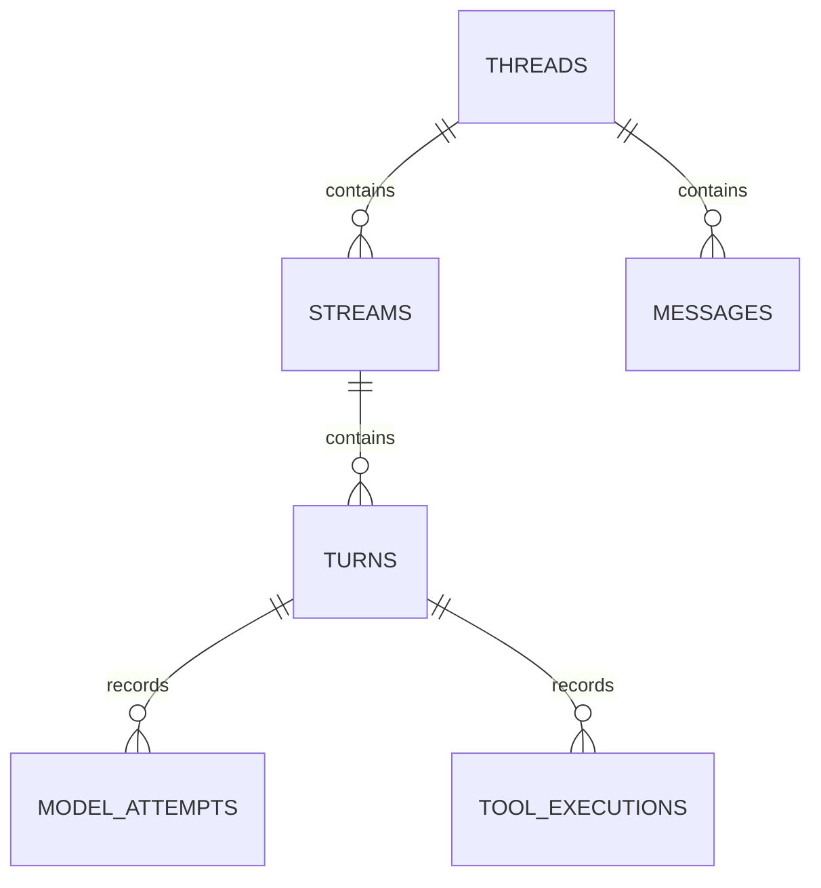

# Tessar state: hội thoại, execution trace và usage

> Historical document — superseded by [Minimal Core Design](2026-10-15-tessar-minimal-core-design.md) and its English implementation plan.

Runtime ownership đã chốt sau review: Controller initialize và sở hữu
storage/registry/resources; Session thao tác Thread qua session.thread.*.
Agent vẫn cung cấp cùng core loop/contracts. Schema state bên dưới không
biến Controller/Session thành owner vĩnh viễn của Thread hay thành scope.

Ngày: 2026-10-14.

Trạng thái: schema chi tiết đề xuất để review. Định hướng đã xác nhận:
Thread là hội thoại; host Session có thể chứa nhiều threads; Stream chứa
nhiều turns; state phải có trace/usage của từng turn. Telemetry bên ngoài
như Langfuse là plugin. Chưa có database schema hoặc implementation.

Schema checkpoint/interrupts và transitions được cụ thể hóa trong
[public API/state machine](2026-10-15-tessar-public-api-state-machine-design.md)
ngày 2026-10-15. Các bổ sung dưới đây phục vụ review cùng bản contract đó,
đã được người dùng chốt để viết implementation plan. Chưa có code, database
schema vật lý hoặc runtime tests.

## 1. Ownership và các nhóm dữ liệu

Core sở hữu state hội thoại hợp lệ, execution records và toàn bộ storage/
state management: logical schema, revisions, commit/checkpoint coordination,
serialize/restore, query/filter và fork. Backend trong bộ nhớ có sẵn mặc định;
plugin chỉ chọn nơi lưu khác và triển khai backend I/O theo cùng contracts.
Plugin telemetry export records sang hệ thống bên ngoài, không tạo dữ liệu
usage nền tảng thay core. Checkpoint schema/signatures chi tiết còn cần chốt.

Một host Session là phiên sử dụng hoặc nhóm threads của application. Nó
không phải identity của hội thoại và không là foreign key bắt buộc trong
schema core. Host có thể lưu session state qua khả năng riêng của nó.

Scope là plain-object metadata do application cung cấp để filter state,
ví dụ userId/workspaceId. Engine, registries và plugin definitions dùng chung.
Scope không có constructor, không thay identity của record và không tạo
một runtime hoặc authentication boundary.

Scope metadata khác lifecycle owner. Host Session giữ defaults/filters khi
list/get/create/fork; Thread lưu metadata thực tế của hội thoại. Core forward
metadata vào child execution records và plugin state theo contracts. Plugin
subagent có thể tạo thread con với metadata rõ ràng mà không cần host Session.

Storage APIs nhận scope filters cùng entity IDs. Adapters chọn columns/JSON
indexes hoặc document filters phù hợp với fields do application dùng; không
ép scope metadata thành composite primary key. Matching semantics và cách
override/merge filters cần được chốt trong contract. Host sở hữu access control.

Các tên bảng dưới đây là mapping SQL đề xuất của logical records. MongoDB
hoặc file adapter có thể tổ chức khác, nhưng phải giữ cùng IDs, relationships,
ordering và usage semantics mà public storage contract yêu cầu.



## 2. Logical records và bảng đề xuất

### threads

| Trường | Ý nghĩa |
| --- | --- |
| id | ID hội thoại, giữ nguyên khi mở lại |
| scope | Metadata phục vụ filter hội thoại, do host cung cấp |
| schemaVersion | Phiên bản cấu trúc thread snapshot |
| revision | Phiên bản canonical state, dùng để phát hiện stale writes |
| currentCheckpointId | Head đã được core publish; chỉ tham chiếu checkpoint đầy đủ |
| activeStreamId | Execution đang running/suspended/interrupted cần tiếp tục, nullable |
| instructions | Normalized InstructionData bổ sung của Thread, nullable; Agent có instructions nền riêng |
| parentThreadId, sourceCheckpointId, forkPointMessageId | Lineage của một fork, nếu có |
| metadata | JSON metadata của host, không tự đưa vào prompt |
| usageSummary | Projection tổng hợp usage của các attempts thuộc thread, có coverage |
| createdAt, updatedAt | UTC timestamps |

Messages được trả theo thứ tự trong ThreadSnapshot. Actor/tenant identity
có thể là host metadata hoặc adapter-specific columns; core không bắt
application dùng một mô hình users/workspaces cụ thể. Host kiểm tra quyền
truy cập thread trước khi sử dụng SDK.

Public getHistory trên Session/Thread đọc canonical messages có phân trang
theo position và checkpoint revision. Cursor giữ snapshot nhất quán khi có
messages mới; không dùng một page history làm toàn bộ model request context.
History giữ content parts/provider state, không trộn trace/plugin state vào
messages. Chi tiết options/outcomes theo public API/state machine mục 5.3.

### streams

| Trường | Ý nghĩa |
| --- | --- |
| id, threadId | Identity của execution và hội thoại |
| scope | Metadata kế thừa từ thread để filter execution records |
| parentStreamId | Liên kết child execution khi có orchestration |
| triggerMessageId | Input message khởi phát stream, nếu input được commit |
| status | pending, running, suspended, completed, failed, cancelled, stopped hoặc interrupted |
| stopReason | Lý do kết thúc có kiểu/code rõ ràng |
| startedAt, endedAt | Thời điểm bắt đầu/kết thúc logical execution; endedAt chưa có khi running hoặc suspended |
| durationMs | Tổng active execution segments đo trong từng runtime; không trừ monotonic timestamps của hai processes |
| error | ErrorInfo khi execution lỗi |
| directUsage | Usage của model attempts thuộc chính stream |
| inclusiveUsage | Usage gồm child streams khi application muốn tổng hợp |

Interrupted biểu thị record chưa có terminal outcome hợp lệ sau khi runtime
kết thúc bất thường, không giả làm cancelled hoặc completed. Việc nhận diện
orphaned executions cần ownership/liveness của storage adapter; không đánh
dấu interrupted chỉ vì một process vừa load record đang running.

Suspended là execution chủ động chờ external input: checkpoint và pending
request đã được lưu trước khi phát StreamSuspended. Lượt đọc events hiện
tại kết thúc, nhưng StreamRecord chưa có terminal outcome/endedAt. Resume
qua API streaming trả handle mới và tiếp tục cùng streamId, dùng interruptId
để correlate phản hồi. Không tạo execution record mới hoặc tính lại usage
đã ghi chỉ vì resume. Core kiểm tra checkpoint, ownership và capabilities
cần cho bước tiếp theo. Checkpoint không khóa model tương lai: resume mặc
định giữ selection cũ, dev được chọn model khác tường minh cho request mới.
Core/adapter validate messages/tools/provider state trước lời gọi model;
không sửa model đã ghi trong attempts cũ. Attempt dang dở không được ghép
token sang model mới; thay model cần attempt mới với trace/usage riêng.
Kiểm tra tool payload đã duyệt là yêu cầu độc lập với việc chọn model.
Plugin/version/resource lifecycle qua suspension vẫn cần review.

Stream được plugin xử lý input trực tiếp có thể không có turn hoặc model
attempt. Khi thật sự không gọi model, usage của stream đó là 0 được biết rõ.

Qua restart/resume, thời gian chờ HITL và active duration là hai metrics
khác nhau. Chỉ tổng hợp các segments có timing đã ghi; phần bị mất do crash
phải có coverage, không điền 0 hay giả thời gian chính xác.

### turns

| Trường | Ý nghĩa |
| --- | --- |
| id, streamId | Identity của một vòng model/tools |
| scope | Metadata kế thừa từ stream |
| index | Thứ tự turn trong stream |
| contextRevision | Revision của thread khi bắt đầu chuẩn bị context |
| assistantMessageId | Message được commit từ primary model call, nếu có |
| startedAt, endedAt, durationMs | Timing của turn |
| status, stopReason, error | Kết quả và nguyên nhân của turn |
| usage | Tổng hợp các model attempts thuộc turn, kèm coverage |

Một turn gồm primary model request và các tool calls phát sinh từ response
đó. Retry vẫn thuộc turn đó nhưng tạo model attempt mới. Auxiliary model
calls chạy trong tools/plugins được ghi riêng và gắn với turn khi chúng đi
qua tracked model execution API của SDK.

TurnRecord là public data contract. Không yêu cầu thêm một Turn class có
lifecycle mà application phải construct để bắt đầu Stream.

### model_attempts

| Trường | Ý nghĩa |
| --- | --- |
| id, turnId | Identity của từng lần thực sự gọi provider |
| scope | Metadata kế thừa từ turn |
| callId, attemptIndex | Nhóm các retries của cùng một logical model call |
| purpose | primary hoặc auxiliary |
| parentToolExecutionId | Liên kết model call do tool khởi phát, nếu có |
| providerId, modelId | Adapter/model thực sự được gọi |
| providerRequestId | ID từ provider khi có |
| responseMessageId | Message đích nếu attempt tạo response được commit |
| contextRevision, requestSnapshotRef | Context revision và optional reference tới normalized request snapshot |
| startedAt, firstOutputAt, endedAt | Timing; firstOutputAt nullable |
| durationMs, timeToFirstOutputMs | Thời gian đo trong runtime, nullable nếu chưa biết |
| status, finishReason, error | Trạng thái và kết quả attempt |
| usage | Normalized ModelUsage của chính attempt |

Attempts bị lỗi/hủy vẫn có records và giữ usage đã được provider báo. Usage
không biến mất chỉ vì assistant message chưa được commit. Timing chưa đo
được là null; không tự điền 0.

Core không thấy model call mà plugin tự gọi HTTP ngoài SDK. Để đưa call đó
vào usage accounting chung, plugin dùng tracked model execution contract
hoặc đăng ký measurement có identity/provenance hợp lệ. Không tuyên bố có
đủ usage của toàn ứng dụng chỉ từ các model calls core biết.

### tool_executions

| Trường | Ý nghĩa |
| --- | --- |
| id, turnId, toolCallId | Execution identity và correlation với assistant tool call |
| scope | Metadata kế thừa từ turn |
| parentToolExecutionId | Liên kết nested tool call, nếu SDK hỗ trợ |
| toolName | Tool đã được registry resolve |
| arguments | Arguments chuẩn hóa đã được validate, khi hợp lệ |
| policyDecision | allowed hoặc denied, kèm reason khi có |
| status | pending, running, succeeded, failed, denied, cancelled hoặc interrupted |
| startedAt, endedAt, durationMs | Timing; denied tool chưa chạy có startedAt null |
| resultMessageId | ToolMessage được commit nếu có |
| resultRef, error | Reference tới kết quả hoặc ErrorInfo |

Tool call bị từ chối vẫn có record. Tool không trực tiếp có model tokens;
tokens của nested model calls nằm ở model_attempts và được liên kết qua
parentToolExecutionId. Không cộng lại cùng usage vào cả tool và turn.

### messages

| Trường | Ý nghĩa |
| --- | --- |
| id, threadId | Message identity trong hội thoại; copied fork prefix có thể giữ id với threadId riêng |
| scope | Metadata kế thừa từ thread |
| position | Vị trí trong canonical message list của revision hiện tại |
| role | system, user, assistant hoặc tool |
| content | Structured content parts theo MessageData contract |
| toolCallId | Có ở ToolMessage, dùng để nối với assistant tool call |
| originStreamId, originTurnId | Execution tạo message; nullable cho initial/imported data |
| metadata | JSON metadata có namespace |
| createdAt | Timestamp của message |

Assistant content biểu diễn text/reasoning/tool calls bằng parts có kiểu.
ToolMessage giữ model-facing result content và metadata đã được công bố.
Raw provider payload không thay thế normalized MessageData.

Provider state/signatures gắn với message/part được MessageCodec bảo toàn
để adapter có thể tiếp nối reasoning/tool workflows. Context transforms
không tự sửa hoặc bỏ những units mà provider contract yêu cầu giữ nguyên.

Position thể hiện thứ tự trong snapshot, không là identity của message.
Reorder/compaction cập nhật positions trong một state mutation hợp lệ.
SchemaVersion của ThreadSnapshot và MessageCodec xác định phiên bản message
format; storage adapter có thể thêm format version nếu lưu messages độc lập.

### plugin_states

| Trường | Ý nghĩa |
| --- | --- |
| pluginId | Namespace owner |
| scope | Metadata filter do application chọn |
| ownerType, ownerId | agent, session, thread, stream hoặc turn cùng lifecycle identity |
| schemaVersion | Phiên bản payload do plugin sở hữu |
| revision | Phiên bản plugin state |
| data | Serializable JSON payload của plugin |
| updatedAt | Timestamp cập nhật |

Durable agent-scoped state dùng Agent.id do dev khai báo; Controller cũng
có ID config do dev cấp, không dùng identity tạm của JS instance. Hai IDs
này không thay lease/fencing token của live process. Session không yêu cầu
public ID; session-owned runtime data không tạo thêm yêu cầu nhập id khi
createSession. Core không inspect business schema trong data.
Plugin chịu trách nhiệm migrations của payload riêng.

Plugin state lookup dùng pluginId/ownerType/ownerId và scope filters tương
ứng. Một plugin runtime dùng chung vẫn cần dùng đúng filters của execution.
Session state của host có thể được lưu bằng capability riêng hoặc một
plugin-state namespace; không cần bảng users/sessions bắt buộc trong core.

### checkpoints

Logical schema đề xuất theo public API/state machine:

| Trường | Ý nghĩa |
| --- | --- |
| id, threadId | Identity của checkpoint bất biến và Thread sở hữu |
| parentCheckpointId | Checkpoint trước trong cùng Thread, nullable ở checkpoint đầu |
| revision, schemaVersion, createdAt | State revision, codec version và thời điểm tạo |
| state | ThreadState gồm messages/instructions/scope/metadata và plugin states liên quan |
| execution | ExecutionPosition nullable: phase, stream/turn, handler cursor, pending tool/interrupt IDs, budgets, model selection, base instructions snapshot, registry requirements |
| cause | Core boundary đã tạo checkpoint, không chứa policy của tính năng chuyên biệt |

Backend có thể lưu state bằng immutable refs/delta chain thay full copy;
head chỉ được publish khi mọi references cần khôi phục đã đầy đủ. Trace
không bị copy toàn bộ vào mỗi checkpoint. Parent chain không nối sang
Thread source khi fork; sourceCheckpointId nằm ở Thread lineage riêng.

### interrupts

| Trường | Ý nghĩa |
| --- | --- |
| id, threadId, streamId | Stable identity cho request/response correlation |
| checkpointId | Checkpoint đang chờ đã được publish |
| definitionId, definitionVersion, pluginId | Contract validate/resolve và namespace owner |
| payload, responseSchema | Serializable request data và schema của phản hồi |
| actionRef | Optional binding/digest cho pending operation cần quyết định |
| status | pending, resolved hoặc cancelled |
| response, resolvedDecision | Nullable trước khi response được consume |
| createdAt, resolvedAt, revision | Timing và optimistic concurrency |

Core consume response, decision và continuation cursor trong cùng atomic
publication. Hai callers không cùng tiếp tục execution. Response invalid
không consume request; caller thua CAS nhận AlreadyResumed. Record này
không phải Promise/callback đang sống và không phụ thuộc UI implementation.

## 3. Usage contract

Usage gốc được ghi ở ModelAttemptRecord. Tất cả token counts không âm; null
có nghĩa metric chưa được báo hoặc không thể chuẩn hóa đáng tin cậy.

| Metric | Semantics chuẩn hóa |
| --- | --- |
| inputTokens | Tổng input tokens, gồm thành phần cache khi adapter xác định được tổng |
| uncachedInputTokens | Phần input không được đọc/ghi cache, khi provider cho phép xác định |
| outputTokens | Tổng generated tokens theo accounting của provider |
| reasoningOutputTokens | Reasoning subset khi provider báo riêng |
| cacheReadInputTokens | Input tokens được đọc từ cache |
| cacheWriteInputTokens | Input tokens được ghi vào cache |
| totalTokens | inputTokens + outputTokens khi cả hai được xác định |

Reasoning/cache breakdown là các thành phần của totals chuẩn hóa. Không
cộng thêm breakdown vào totals lần nữa. Adapter chỉ xác định uncached input
bằng phép trừ khi provider semantics xác nhận các thành phần đó tách biệt
và bao phủ tổng; không suy ra một công thức chung từ tên trường.

Mỗi metric giữ provenance provider, derived, estimated hoặc unavailable.
Core không tự ước lượng một trường bị thiếu. Estimation nếu có là capability
riêng và được ghi nhãn; không thay thế số provider báo mà không giữ nguồn.
Raw usage được giữ trong provider metadata khi có để giải thích mapping.

Types minh họa của normalized usage:

```ts
interface TokenCounts {
  inputTokens: number | null;
  uncachedInputTokens: number | null;
  outputTokens: number | null;
  reasoningOutputTokens: number | null;
  cacheReadInputTokens: number | null;
  cacheWriteInputTokens: number | null;
  totalTokens: number | null;
}

type UsageSource = "provider" | "derived" | "estimated" | "unavailable";

interface ModelUsage extends TokenCounts {
  provenance: Record<keyof TokenCounts, UsageSource>;
  providerDetails?: JsonValue;
}

interface UsageMetricSummary {
  knownTotal: number | null;
  knownAttempts: number;
  totalAttempts: number;
  coverage: "complete" | "partial" | "unavailable";
}

interface UsageSummary {
  metrics: Record<keyof TokenCounts, UsageMetricSummary>;
}
```

Coverage phản ánh mức độ có dữ liệu. Provenance của measurements vẫn phải
được giữ hoặc được tóm tắt cùng aggregate để complete coverage của estimated
values không bị hiểu là toàn bộ tokens đã được provider báo chính xác.

Ví dụ Anthropic báo input_tokens cho phần chưa cache, cùng
cache_read_input_tokens và cache_creation_input_tokens riêng. Adapter cần
tổng hợp các phần đó để tạo inputTokens theo contract của Tessar.
[Anthropic usage breakdown](https://platform.claude.com/docs/en/build-with-claude/prompt-caching#tracking-cache-performance).

Thông tin cache write theo TTL/tier hoặc usage modality riêng được giữ trong
provider metadata có version nếu chưa có normalized field chung. Một app
cache trả response cũ không được tính lại usage của provider request cũ như
tokens mới; cache plugin có metrics riêng cho cache của ứng dụng.

## 4. Quy tắc aggregation và tránh đếm trùng

1. Một attempt ID tương ứng một provider attempt thực tế. Usage updates
   thay thế snapshot hiện tại của attempt, không cộng mỗi streaming update.
2. Nếu provider gửi cumulative counts, adapter chuẩn hóa thành attempt totals.
   Provider reporting increments phải được adapter tích lũy đúng một lần.
3. Turn usage tổng hợp các attempts duy nhất thuộc turn, gồm retries và
   auxiliary calls đã được tracked. Không chỉ tính attempt cuối thành công.
4. Stream directUsage tổng hợp attempts thuộc các turns của chính stream.
5. Inclusive usage có thể gồm descendant streams. Một attempt chỉ được tính
   một lần trong tập descendant IDs; không cộng direct và inclusive totals
   của cùng một subtree.
6. Thread usage tổng hợp các attempts thuộc thread. Model calls của child
   thread không tự được tính lại vào direct usage của parent thread.
7. Mỗi aggregate metric có knownTotal và coverage: số attempts có metric,
   tổng attempts liên quan và complete/partial/unavailable. Partial total
   không được hiển thị như một tổng đầy đủ; null không tự trở thành 0.
8. Aggregates là projections có thể tái tạo từ attempt records. Không dùng
   các totals ở turn/stream/thread như các nguồn usage độc lập để cộng tiếp.

Ví dụ turn có hai attempts: attempt đầu lỗi với 100 input/20 output;
attempt retry thành công với 120 input/30 output. Nếu đều có reported usage,
turn tổng là 220 input/50 output. Nếu attempt đầu không có usage thì tổng
đã biết là 120/30 và coverage phải thể hiện partial.

Token totals không đồng nghĩa context-window occupancy của request hiện tại.
Usage history qua nhiều turns có thể đếm cùng phần prompt nhiều lần; context
budget dùng normalized request/token estimate tại thời điểm gọi model.

## 5. Trace state và telemetry exporter

Core tạo records/correlations/timing, cập nhật normalized usage và phát typed
events tương ứng. Dữ liệu này có sẵn trong execution state dù không có
telemetry plugin. Core storage lưu execution history qua backend được chọn;
mặc định là backend trong bộ nhớ, không lưu qua restart.

Langfuse hoặc một hệ thống khác được tích hợp bằng exporter plugin. Plugin
map Tessar stream/turn/model/tool records sang trace/observations và có
thể thêm plugin-owned spans cho retrieval hoặc compaction. Langfuse mô tả
observations là các bước LLM/tool/retrieval có thể được lồng nhau.
[Langfuse data model](https://langfuse.com/docs/observability/data-model).

External telemetry ID không thay thế identity của core records. Exporter
có thể giữ mapping riêng; lỗi export được báo qua diagnostics, không làm
mất usage đã ghi ở core. Chính sách bắt buộc export có thể được host chọn
tường minh, thay vì mặc nhiên làm mọi execution phụ thuộc một dịch vụ ngoài.

Trace records phục vụ timing/correlation/accounting. Lưu mọi delta, raw
requests, provider responses hoặc arbitrary event log là phần mở rộng có
retention riêng. Core không bắt toàn bộ token stream trở thành persisted log.

## 6. Storage, consistency và phục hồi

ThreadStore và ExecutionStore là các logical backend ports phía sau storage
service có sẵn của core. SQLite/PostgreSQL/MongoDB/file adapter có thể triển
khai chung. Core quản lý state lifecycle, commit/checkpoint và restore;
adapter thực hiện backend I/O, physical migrations/indexes/transaction
primitives theo contract của core. Không ép mọi backend có cùng tên hoặc
cùng số physical tables; plugin không tự định nghĩa nghiệp vụ checkpoint.

Thread mutations dùng expected revision và được validate trước commit.
Quy tắc execution đã chốt: mỗi Thread chỉ có một Stream hoạt động; gọi thêm
trả `ThreadBusy`, các Threads khác nhau có thể chạy đồng thời. Cancellation
không hoàn tác state đã commit hoặc tool side effects; client disconnect
không tự hủy Stream. Khi có nhiều processes cùng truy cập một Thread đã
lưu, cơ chế ownership/coordination của storage adapter vẫn cần thiết kế;
không coi khóa trong bộ nhớ của một instance là khóa toàn hệ thống.
Execution record writes là idempotent theo record ID; update có revision/
sequence để snapshot cũ không ghi đè terminal state hoặc usage mới hơn.
Operations thay canonical messages và trace references cùng lúc cần
commit boundary và consistency semantics rõ ràng của adapter.

Nếu adapter lưu thread state và execution records ở các stores riêng,
không tuyên bố transaction chung. Core storage quản lý failure/reconciliation
theo capabilities và contract của backend; core giữ outcome/timing/usage
gốc ngay cả khi backend writes thất bại.

Đã chốt: core cung cấp checkpoint cùng suspend/resume và recovery tại các
boundary xác định, không chỉ khôi phục hội thoại. State cần lưu execution
position, bước đã hoàn tất và pending external-input requests. Với HITL,
request có identity, payload và trạng thái chờ/đã nhận phản hồi; resume
validate/correlate và ngăn phản hồi bị áp dụng trùng. Representation và
signatures cụ thể của các records này vẫn cần review.

Suspended biểu thị execution chủ động chờ external input, khác interrupted
do runtime kết thúc bất thường. Quyền resume/recovery thuộc core, dùng
consistency primitives của backend để tránh hai processes cùng thực thi.
Plugin chọn policy hỏi/phục hồi và host xử lý UI/transport; backend chỉ
chọn nơi lưu dữ liệu. Khả năng phục hồi qua restart cần backend lưu bền vững.

Core tiếp tục từ dữ liệu đã lưu tại boundary hợp lệ, không khôi phục một
Promise/provider iterator đang sống. Bước đã ghi nhận hoàn tất không tự
chạy lại. Tool side effects chưa xác định sau crash cần idempotency hoặc
reconciliation/recovery decision; không replay mutation tools chỉ vì
record chưa có endedAt. Checkpoint không cung cấp exactly-once cho các
hệ thống bên ngoài.

Core mặc định giữ records của stream đang hoạt động và kết quả của nó.
Lifetime của history trong bộ nhớ/retention lâu dài là policy của host hoặc
core storage; aggregates phải giữ coverage khi raw records đã bị xóa.
Khả năng tái tạo toàn bộ aggregates từ attempts chỉ tồn tại khi raw records
còn được giữ. Nếu retention xóa raw records, core storage cần accounting checkpoint
có boundary/revision rõ ràng trước khi xóa, thay vì tiếp tục cộng totals
không có thông tin phạm vi hoặc làm mất lịch sử usage.
Telemetry retention độc lập với conversation/execution-state retention.

## 7. Tiêu chí review và kiểm chứng sau implementation

- CLI host Session quản lý nhiều threads; backend không cần host Session.
- Dùng chung Agent/runtime; Session và plugin APIs truyền scope filters đúng
  khi đọc state và gắn scope metadata đúng khi tạo history/execution records.
- Messages, streams, turns và attempts giữ được relationships khi save/load.
- Retry lỗi, cancel và provider response không commit vẫn giữ attempt usage
  đã biết; unknown usage được thể hiện rõ.
- Các cumulative usage updates không bị cộng lặp; cache/reasoning subsets
  không bị cộng thêm vào totals.
- Nested calls qua SDK và child streams có correlations và aggregation
  boundaries; không đếm một attempt hai lần.
- Không telemetry plugin vẫn đọc được trace/usage trong state.
- Storage mappings khác nhau giữ cùng logical schema và consistency contracts.
- Codec round-trip giữ IDs/roles/content và không serialize live resources.

Đây là các yêu cầu kiểm chứng cho kế hoạch sau khi schema được duyệt,
không phải báo cáo implementation hoặc tests đã chạy.
