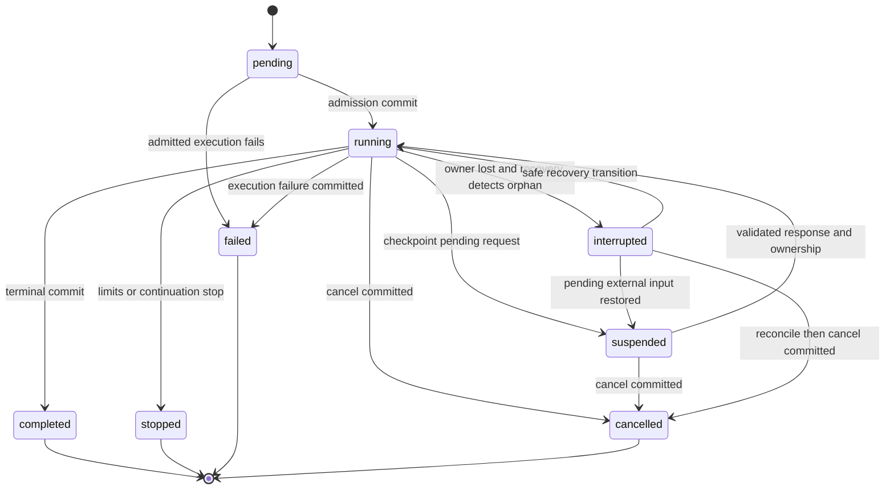
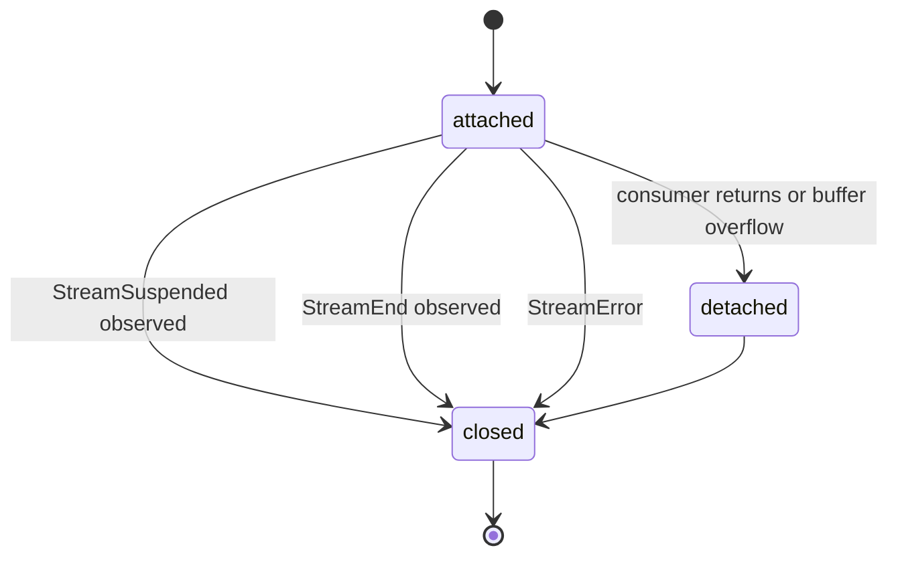

# Tesseract: public API và state machine

Ngày: 2026-10-15.

Trạng thái: người dùng đã chốt thiết kế và yêu cầu viết implementation plan
ngày 2026-10-15. Chưa implement. Các chi tiết kỹ thuật ở kế hoạch là lựa chọn
triển khai có thể review, không phải bằng chứng runtime đã hoạt động.

Cập nhật đã chốt sau review: Controller sở hữu initialization/runtime;
controller.createSession tạo Session; thread operations ở session.thread;
Session có subscribe, abort và followUp. Quyết định này thay các ví dụ
agent.initialize/new Session/session.createThread trong bản nháp trước.
Agent có model mặc định và hai API generate/stream dùng cùng engine.
Session dùng subscribe + followUp, không có send hoặc stream public;
session.thread.switch đổi Thread đang chọn.

## 1. Mục tiêu, phạm vi và cách đọc

Tesseract là framework/SDK độc lập cho CLI agents và agents nhúng trong
application. Cube là consumer. Core tự sở hữu agent loop, state machine,
storage/state management và plugin host. Provider integrations và các khả
năng chuyên biệt đi qua public contracts. Factory như createCodingAgent
ghép plugins trên new Agent, không tạo engine riêng.

Tài liệu này cụ thể hóa ba tài liệu nền:

- [Architecture notes](../../architecture-notes.md): các định hướng đã chốt.
- [Core design](2026-10-14-tesseract-core-design.md): boundaries và event catalog.
- [State design](2026-10-14-tesseract-state-design.md): records, trace và usage.

Sau khi được duyệt, signatures/transitions trong tài liệu này là contract
cho phase hiện tại. Các tài liệu nền được đọc cùng các bổ sung tại đây.
Code blocks là thiết kế API, không phải ví dụ đã chạy. Các type MessageData,
ToolResult, ErrorInfo, StreamRecord, TurnRecord và UsageSummary theo contracts
ở tài liệu nền; không phải mỗi đoạn code là một file TypeScript độc lập.

Những ranh giới đã xác nhận:

| Phần | Chủ sở hữu |
| --- | --- |
| Agent loop, logical state/schema, commit, checkpoint, suspend/resume, recovery, fork | Core |
| Runtime ownership, initialization, plugin resources, model registry và Session factory | Controller sử dụng các cơ chế core |
| Backend trong bộ nhớ mặc định | Core storage |
| Nơi lưu SQLite/Postgres/MongoDB/file hoặc backend khác | Storage backend plugin |
| Model/provider contracts, registry và normalized profile | Core/SDK |
| Provider protocol, auth và metadata acquisition | Provider plugins dùng SDK helpers/adapters |
| Permissions, context policies, orchestration, external telemetry | Plugins |
| UI, routes, authentication, authorization và transport | Application/host |

TD-001: discovery, dynamic code loader và install/update/remove packages
ngoài phạm vi phase này. Application import/khởi tạo plugin instances.
Registration/attach/detach contracts vẫn thuộc phase này.

Phạm vi kiểm chứng đề xuất cho implementation plan: core/SDK cùng memory
backend, một provider helper/plugin, một tool/policy plugin minh họa, một
reference SQLite backend plugin và hai host examples CLI/headless. SQLite
chứng minh checkpoint/HITL qua process restart; nó không trở thành dependency
bắt buộc của core. PostgreSQL/MongoDB/file cùng triển khai được contracts,
không đồng nghĩa phải ship tất cả backend adapters trong phase này.

## 2. Các lựa chọn cụ thể làm baseline triển khai

| Chủ đề | Lựa chọn để review |
| --- | --- |
| Cách cấu hình | Inline hoặc tách biến đều được; cùng contracts, không bắt tạo từng block riêng |
| Instructions | Agent có instructions nền; Thread có thể bổ sung; SDK có buildInstruction, string trực tiếp vẫn hợp lệ |
| Lifecycle | Đã chốt controller.initialize một lần; Agent/Session không có public initialize riêng |
| Session API | Đã chốt controller.createSession, session.thread.*, session.subscribe, session.abort và session.followUp |
| Model profile | SDK tự resolve; model.profile là getter đồng bộ của snapshot đã normalize, không network I/O trong getter |
| Session scope | Flat scalar equality + AND; filters của Session không bị mở rộng bởi từng method call |
| Scope khi fork | Kế thừa source scope trong phase này; không âm thầm đổi user/workspace |
| Tool scheduling | Tuần tự trong phase này; core có limits, plugin quyết định continuation/retry trong limits |
| Storage chính | Required writes; chưa hỗ trợ best-effort cho canonical state/checkpoints trong phase này |
| Stream consumption | AsyncIterable chính, một consumer/handle; bounded buffer, overflow tách consumer và báo lỗi |
| Identity trước admission | handleId có ngay; streamId có thể null trong handle trước khi core lookup/admit được execution |
| Suspend/resume | Suspended đóng lượt đọc events; cùng streamId, handleId mới khi resume |
| Thread đang suspended | Giữ quyền tiếp tục hội thoại cho execution đó; input mới trả ThreadBusy, resume/cancel/recover đi qua transitions riêng |
| Resume response | Validate, correlate và consume bằng atomic transition; phản hồi trùng không thực thi lần nữa |
| Recovery | Qua API streaming, dùng durable cursor/results; unknown tool side effects cần reconcile hoặc quyết định tường minh |
| Fork | Tạo Thread độc lập từ checkpoint an toàn; không copy pending execution/interrupts hoặc usage thành usage mới |

Người dùng đã chốt hướng thiết kế này. Implementation plan cụ thể hóa package
boundaries, storage ports, tests và thứ tự triển khai; chưa có code hoạt động.

## 3. Agent, Controller và composition

```ts
interface AgentOptions {
  id: string;
  model?: Model | ModelRef;
  instructions?: string | Instruction;
  plugins?: readonly Plugin[];
  limits?: Partial<StreamLimits>;
}

interface StreamLimits {
  maxTurns: number;
  maxModelAttempts: number;
  maxToolCalls: number;
}

class Agent {
  constructor(options: AgentOptions);
  readonly id: string;
  stream(options: AgentExecutionOptions): Stream;
  // Cùng engine, semantics ở mục 5.6:
  generate(options: AgentExecutionOptions): Promise<GenerateOutcome>;
}

class Controller {
  constructor(options: { id: string; agent: Agent });
  readonly id: string;
  readonly agent: Agent;
  readonly models: ModelRegistry;
  readonly plugins: PluginManager;

  initialize(): Promise<void>;
  createSession(options: ControllerSessionOptions): Session;
  createThread(options?: CreateThreadOptions): Promise<Thread>;
  getThread(id: string, query?: StateQuery): Promise<Thread | null>;
  listThreads(query?: ThreadListQuery): Promise<Page<ThreadInfo>>;
  deleteThread(id: string, query?: StateQuery): Promise<void>;
  forkThread(id: string, options?: ControllerForkOptions): Promise<Thread>;
  dispose(): Promise<void>;
}

interface Plugin {
  readonly id: string;
  readonly apiVersion: number;
  setup(api: PluginContext): void | Disposer | Promise<void | Disposer>;
}

type Disposer = () => void | Promise<void>;
```

Constructors đồng bộ, không gọi model/network/storage I/O. Controller.initialize
chạy plugin setup, chọn một backend hoặc memory backend, chuẩn bị model registry
rồi chuyển ready. Initialize đồng thời chia sẻ cùng Promise. Controller.dispose
đóng runtime/resources theo lifecycle; không có agent.initialize/dispose public.

Một Controller/Agent có thể phục vụ nhiều Sessions/Threads. Agent có model
mặc định bất biến, không có current model mutable dùng chung. Session có
selection riêng; per-call override không đổi default. Một Agent instance được bind vào một
Controller runtime trong phase này; không âm thầm chọn giữa hai runtimes.
Agent.stream/generate dùng runtime đã ready đó, không init một runtime thứ hai.
Plugin có thể là class hoặc object thỏa Plugin; SDK
không bắt developer kế thừa base class.

```ts
const provider = new OpenAIPlugin({ apiKey });

const agent = new Agent({
  id: "application-assistant",
  instructions: "You are the application's assistant.",
  plugins: [provider, applicationTools, applicationPolicy],
});
const controller = new Controller({ id: "application-runtime", agent });
await controller.initialize();
```

Có thể inline new OpenAIPlugin trong plugins. Instance chứa resource mutable
không tự được chia sẻ cho nhiều Agents; quyền sở hữu resource phải theo
options của plugin. Các tên applicationTools/applicationPolicy là plugin
instances của application, không phải tính năng built-in của Tesseract.

Limits mặc định: 32 turns, 64 model attempts và 128 tool calls mỗi
logical Stream. Budgets được lưu và tiếp tục đếm qua suspend/recovery;
resume không reset budgets. Dev có thể cấu hình explicit. Core không tự retry
model/tool chỉ vì còn budget; model retry vẫn là typed plugin decision.

### 3.1. IDs do dev định danh

Đã chốt: tạo Agent và Controller bắt buộc có id do dev tự đặt; SDK không tự
generate ID cho hai đối tượng này. ID là chuỗi không rỗng, được giữ nguyên
qua config/checkpoint references; không lấy scope hoặc JS object identity
thay cho logical Agent/Controller ID. Factory như createCodingAgent nhận và
truyền options.id về cùng Agent nền, không tự gán ID thay application.

Session không yêu cầu id trong createSession và không expose Session.id.
Session nhận scope để filter state; scope không bị biến thành primary identity
và hai Sessions có cùng scope vẫn có thể tồn tại độc lập. Runtime có thể có
private handles để quản lý subscription, nhưng không tạo thêm yêu cầu dev
tự định danh Session. Thread/Stream/checkpoint/message IDs giữ contracts đã có.

Controller.id là logical config/runtime identity, không phải lease owner token
của một process. Hai processes của cùng application có thể dùng cùng IDs;
ownership/fencing phải dùng token riêng để phân biệt các executions sống.

## 4. Model handle và profile tự động

```ts
interface ModelRef {
  providerId: string;
  modelId: string;
}

interface ModelRegistry {
  get(ref: ModelRef): Model;
  list(): readonly Model[];
}

interface Model {
  readonly ref: Readonly<ModelRef>;
  readonly profile: Readonly<ModelProfile>;
  refreshProfile(options?: { signal?: AbortSignal }): Promise<ModelProfile>;
}

interface ModelProfile {
  readonly providerId: string;
  readonly modelId: string;
  readonly name: string | null;
  readonly contextWindow: number | null;
  readonly maxInputTokens: number | null;
  readonly maxOutputTokens: number | null;
  readonly capabilities: {
    readonly tools: boolean | null;
    readonly reasoning: boolean | null;
    readonly structuredOutput: boolean | null;
    readonly imageInput: boolean | null;
    readonly audioInput: boolean | null;
    readonly audioOutput: boolean | null;
  };
  readonly pricing: ModelPricing | null;
  readonly metadata: ProfileMetadata;
}
```

Model là handle từ registry, không phải provider HTTP client. Không cần new
ModelProfile hay nhập context window/capabilities để tạo handle. ProviderId
phải có registration. Model ID chưa có catalog vẫn có thể tạo handle, với
profile partial/unavailable; provider có thể reject model ID khi gọi API.

get dùng identity {providerId, modelId} để tránh nhầm model của hai endpoints.
Không đoán provider từ tên model. Gateway/provider registrations có identity
riêng dù dùng cùng một protocol helper.

profile getter đọc snapshot đã normalize ngay lập tức. initialize chuẩn bị
catalog/cache; get tạo snapshot từ dữ liệu sẵn có và tự lên lịch metadata
resolution khi cần. Khi resolve xong, SDK thay snapshot nguyên tử. Instance
profile đã trả trước đó vẫn bất biến. refreshProfile là API chủ động refresh,
không phải bước bắt buộc để dev có profile.

### 4.1. Nguồn metadata và quy tắc resolution

Đề xuất SDK có bundled catalog snapshot từ models.dev, được normalize khi
phát hành SDK, cùng provider metadata resolvers trong helpers. Không đưa
catalog tên model của từng hãng vào agent loop. SDK tự refresh catalog đã
cache trong background; metadata/network lỗi không làm Agent init thất bại.

Thứ tự ưu tiên theo từng field:

1. Metadata trực tiếp của đúng provider/endpoint khi API có cung cấp field.
2. Catalog entry khớp provider/model hoặc alias mapping tường minh của helper.
3. Snapshot catalog đi kèm SDK làm fallback offline.
4. Chưa xác định thì null, kèm provenance/unavailability.

Không fuzzy-match model ID; không lấy giá của hãng gốc làm giá gateway nếu
không có mapping serving/pricing hợp lệ. Canonical model metadata chỉ bổ
sung các facts thật sự độc lập provider. Resolver không gửi credentials hay
conversation state tới catalog service. Profile cache của endpoint có
metadata theo account phải được partition theo provider registration/auth
identity; không dùng một shared cache chứa dữ liệu riêng cho mọi users.

ProfileMetadata chứa completeness complete/partial/unavailable, freshness
fresh/stale/unknown, fetchedAt, source revisions và provenance theo field.
TTL refresh mặc định là 24 giờ; stale data vẫn đọc được có đánh dấu.
Không bắt dev điền tay khi source lỗi hoặc chưa có model custom.

ModelPricing có currency và pricing basis rõ ràng; flat rates tính trên
1 triệu tokens, các trường input/output/cache/reasoning nullable. Nguồn có
tiered/conditional pricing phải giữ tiers/conditions, không ép thành một số
giá flat sai. Đây là metadata để ước tính, không phải hóa đơn thực tế.

Unknown capability không tự bật tính năng. Adapter vẫn validate normalized
request; metadata false/capability không hỗ trợ được báo rõ. Thiếu metadata
không tự cấm model tạo text. Context-window enforcement chỉ được khẳng định
khi có giới hạn đã biết; không tự tạo một context window mặc định giả.

Căn cứ chọn cơ chế, kiểm tra tài liệu ngày 2026-10-15:

- [OpenAI Retrieve model](https://developers.openai.com/api/reference/resources/models/methods/retrieve)
  mô tả thông tin cơ bản của model; schema hiện không cung cấp đủ context,
  capabilities và pricing để dựa riêng endpoint này cho profile đầy đủ.
- [Google Model resource](https://ai.google.dev/api/models#Model) có input/output
  token limits và các thông tin generation. Coverage khác nhau theo provider.
- [Models.dev README](https://github.com/anomalyco/models.dev#api) công bố API
  catalog và phân biệt model facts với provider-specific serving/pricing.

Việc dùng models.dev là lựa chọn đề xuất của bản này, chưa phải integration
đã chạy. Không hứa profile đầy đủ cho mọi model hoặc mọi custom endpoint.

## 5. Session, Thread và scope

```ts
type Scope = Readonly<Record<string, string | number | boolean>>;

interface ControllerSessionOptions {
  model?: Model | ModelRef;
  scope?: Scope;
}

class Session {
  readonly controller: Controller;
  readonly agent: Agent;
  readonly scope: Scope;
  readonly model: Model;
  setModel(model: Model | ModelRef): void;

  readonly thread: SessionThreadApi;
  subscribe(handler: SessionEventObserver): Disposer;
  subscribe<D extends EventDefinition>(definition: D, handler: EventObserver<D>): Disposer;
  resume(options: SessionResumeOptions): Promise<ExecutionReceipt>;
  recover(options: SessionRecoverOptions): Promise<ExecutionReceipt>;
  abort(reason?: string): Promise<void>;
  followUp(input: Message | readonly Message[]): Promise<QueuedInputReceipt>;
  dispose(): Promise<void>;
}

interface SessionThreadApi {
  create(options?: SessionThreadOptions): Promise<Thread>;
  switch(id: string): Promise<Thread>;
  get(id: string): Promise<Thread | null>;
  getId(): string | null;
  list(options?: PageOptions): Promise<Page<ThreadInfo>>;
  rename(title: string, target?: ThreadTarget): Promise<void>;
  fork(options?: ForkOptions & ThreadTarget): Promise<Thread>;
  delete(target?: ThreadTarget): Promise<void>;
  getHistory(options?: HistoryOptions & ThreadTarget): Promise<HistoryPage>;
}

interface ThreadTarget { threadId?: string }

interface CreateThreadOptions {
  title?: string;
  scope?: Scope;
  instructions?: string | Instruction;
  messages?: readonly Message[];
  metadata?: JsonObject;
}

type SessionThreadOptions = Omit<CreateThreadOptions, "scope">;
interface StateQuery { scope?: Scope }
interface PageOptions { cursor?: string; limit?: number }
type ThreadListQuery = StateQuery & PageOptions;
interface Page<T> { items: readonly T[]; nextCursor: string | null }

interface HistoryOptions extends PageOptions {
  atCheckpointId?: string;
}

interface HistoryPage extends Page<Message> {
  checkpointId: string;
  revision: number;
}

class Thread {
  readonly id: string;
  readonly scope: Scope;
  snapshot(): Promise<ThreadSnapshot>;
  getHistory(options?: HistoryOptions): Promise<HistoryPage>;
  stream(options: ThreadStreamOptions): Stream;
  getCheckpoint(id: string): Promise<Checkpoint | null>;
  listCheckpoints(options?: PageOptions): Promise<Page<CheckpointInfo>>;
  getStream(id: string): Promise<StreamRecord | null>;
  listStreams(options?: PageOptions): Promise<Page<StreamRecord>>;
  listTurns(streamId: string, options?: PageOptions): Promise<Page<TurnRecord>>;
  listModelAttempts(turnId: string, options?: PageOptions): Promise<Page<ModelAttemptRecord>>;
  listToolExecutions(turnId: string, options?: PageOptions): Promise<Page<ToolExecutionRecord>>;
  getInterrupt(id: string): Promise<InterruptRecord | null>;
  listInterrupts(options?: PageOptions & {
    status?: "pending" | "resolved" | "cancelled";
  }): Promise<Page<InterruptRecord>>;
  cancelStream(streamId: string, reason?: string): Promise<void>;
  dispose(): Promise<void>;
}
```

Message gồm SystemMessage/HumanMessage/AssistantMessage/ToolMessage của SDK.
ThreadSnapshot chứa current revision/state, activeStreamId nullable và usage
projection. ThreadInfo/CheckpointInfo là list projections của cùng identity,
scope, revision, status/time fields; không chứa tất cả messages.
CheckpointInfo có forkable boolean và unsafeReason nullable do core tính
từ prefix invariants; list/query không cần host tự phân tích tool-call chain.
Các methods của Thread luôn ràng buộc threadId/scope của handle; interrupt
của Thread khác không được resolve qua handle này. Trace chi tiết tiếp tục
qua public read queries cho TurnRecord/ModelAttemptRecord/ToolExecutionRecord
của cùng Thread, không qua raw backend client.

Scope chỉ là scalar metadata. Matching exact equality trên từng field trong
filter, kết hợp AND, phân biệt type. {} không filter; absent field không match
một filter có field đó. Không biến scope thành identity/constructor/DI scope.

Session nhận scope một lần. thread.create gắn nó; get/list/delete/fork áp dụng
nó. Không có per-call override để vô tình mở rộng filter của Session. Muốn
làm việc với filter khác, host dùng Session khác hoặc public Controller APIs.
createSession resolve model option rồi Agent default; thiếu cả hai báo
MissingModel. Không cần nhập lại model nếu Agent đã cấu hình default.
Các execution operations của Session dùng Thread đang chọn, kiểm tra cùng runtime/scope.
Thread đã được lấy qua SDK mang scope thật của state; không phải scope copy
của một Session trở thành owner vĩnh viễn.

thread.get trả null nếu không có record match ID+filter. Không tự tạo Thread.
Host tự kiểm tra access control trước lời gọi SDK. Scope không thay authorization.
Pagination dùng stable cursor theo createdAt/id, limit mặc định 50, tối đa 200.
Riêng message history phân trang theo canonical position tại một checkpoint,
không theo timestamp; xem getHistory ở mục 5.3.
Snapshot/list/checkpoint reads không đụng current model của Session.

thread.delete yêu cầu không còn execution running/suspended/interrupted cần
recovery; nếu có trả ThreadBusy. Host cancel/recover trước khi delete. dispose
chỉ là lifecycle tài nguyên runtime, không phải xóa persisted state.

### 5.1. Session là facade, không là điều kiện của core

Plugin/subagent có thể dùng Controller.createThread({scope, ...}) và Thread.stream
với model tường minh. Các Controller state methods nhận scope filter ở public SDK
để plugin authors không cần truy cập internal store. AgentForkOptions ở bản cũ
được đổi tên ControllerForkOptions, gồm
ForkOptions và scope filter dùng để lookup source; target kế thừa source scope.

Controller sở hữu runtime/registry/resources; Agent định nghĩa hành vi và
agent loop; Session có current model/scope/current Thread; Thread chứa hội
thoại; Stream là execution. Không thêm Run class hoặc mandatory Turn instance.

SessionThreadApi là facade quản lý/chọn Thread, không là Thread state.
create tự chọn Thread mới sau khi commit; switch đổi lựa chọn sau lookup
thành công; get chỉ đọc. getId đọc selection hiện tại hoặc null. rename
lưu title vào metadata.title. fork trả Thread mới, không tự đổi selection.
delete current Thread thành công thì clear selection. Methods có ThreadTarget
mặc định dùng selection hiện tại; không có selection báo NoThreadSelected.

Session followUp/resume/recover chụp Thread tại lúc gọi; execution không trôi sang Thread
khác sau đó. Mặc định đề xuất một foreground execution mỗi Session; lúc đang
chạy, create/switch/resume/recover foreground khác báo SessionBusy; followUp xếp hàng. Nhiều Sessions
trên một Controller và public Thread APIs vẫn hỗ trợ các Threads chạy song song.

subscribe trả unsubscribe/disposer, nhận SessionEvents và events của executions
khởi phát qua Session đó. Có overload typed definition hoặc toàn event union.
Đây là observation API, không là policy/interception hook. Handler lỗi báo
diagnostics. Session chỉ expose subscription; không tạo iterator buffer không
được đọc. Agent.stream và Thread.stream vẫn cung cấp iterator cấp thấp.

abort yêu cầu cancel foreground execution hoặc pending execution của Thread
đang chọn khi đang suspended, không xóa Thread/đóng runtime. ID đang chạy
được chụp trước khi dispatch cancellation, không trôi theo một selection mới.
Promise xác nhận cancellation được nhận; terminal outcome qua events sau khi
core cleanup/commit xong. Side effects vẫn theo cancellation/recovery contract.

followUp xếp input FIFO, bind threadId và model selection lúc enqueue. Promise
trả QueuedInputReceipt {id,threadId}, không phải câu trả lời model. Khi execution
trước completed và Thread hợp lệ, SDK tạo Stream mới cho input kế tiếp; nếu
idle thì có thể admit ngay. Suspended giữ queue, không bị followUp vượt qua.
Completed tiếp tục FIFO; failed/cancelled/stopped discard phần queue chưa admit,
phát InputDiscarded có receipt/cause; input mới tường minh có thể mở execution
mới sau terminal. Queue runtime của Session trong phase này chưa được coi là durable
input admission; chỉ input đã dequeue/commit mới thuộc execution checkpoint.
dispose Session kết thúc queue chưa admit. Độ bền của queue không được suy ra
từ khả năng checkpoint của execution đang chạy.

### 5.2. Message và tool primitives

SystemMessage/HumanMessage/AssistantMessage nhận string hoặc structured
content theo MessageData contract. ToolMessage nhận toolCallId và content.
MessageCodec round-trip IDs, part order và opaque provider state. Custom
metadata có namespace, không tự tạo role ngoài model contract.

Tool class và createTool dùng cùng Tool definition/execution contract; helper
trả Tool, không tạo executor thứ hai. InputDefinition<T> chứa JSON Schema
model-facing cùng parser/validator suy ra T. ToolResult theo structured
content contract của core. Không bắt dùng một schema library cụ thể.

```ts
const lookup = createTool({
  name: "lookup_document",
  description: "Read one application document.",
  input: documentInputDefinition,
  async execute(input, context) {
    return readDocumentAsToolResult(input.id, { signal: context.signal });
  },
});
```

ToolExecutionContext có identities, signal, thread/state access và tracked
model-call API. Plugin/tool cần auxiliary model call dùng context.models.stream
để core ghi purpose=auxiliary và usage vào đúng stream/turn/tool execution;
không tự gọi HTTP rồi mặc nhiên được core biết tokens. Tính năng provider
helper và tracked execution dùng cùng ModelAdapter/ModelRequest contracts.

### 5.3. getHistory cho lịch sử hội thoại

```ts
const history = await session.thread.getHistory({ threadId, limit: 50 });
// Khi đã có Thread handle, dùng cùng contract:
const sameHistory = await thread.getHistory({ limit: 50 });

const older = history.nextCursor
  ? await thread.getHistory({ cursor: history.nextCursor, limit: 50 })
  : null;
```

getHistory trả canonical messages đã commit, được MessageCodec decode thành
SDK message instances và giữ structured parts/provider state. Nó không trả
usage/trace records, plugin state hoặc context projection đã chuẩn bị cho
model. snapshot lấy toàn bộ Thread state; getHistory chỉ đọc messages có
phân trang để host/plugin không phải load toàn snapshot.

Trang đầu mặc định lấy tối đa limit messages gần nhất, items theo thứ tự
hội thoại từ cũ tới mới. nextCursor đi về trang cũ hơn; null khi hết prefix.
Cursor ràng buộc threadId, checkpointId/revision và position, nên messages
commit trong lúc host cuộn không gây lặp/bỏ sót. Gọi không cursor để lấy head
mới nhất. atCheckpointId cho phép đọc history của một mốc cụ thể; nếu dùng
cùng cursor phải khớp checkpoint, không âm thầm chuyển sang revision khác.

Session áp scope filter đã nhận, không truyền scope lần hai. Thread handle
dùng identity/scope của nó; checkpoint/cursor thuộc Thread khác bị reject.
History của Thread rỗng trả items=[], nextCursor=null và checkpoint identity;
Thread không tồn tại/mismatch scope báo ThreadNotFound ở operation này.
Invalid cursor/checkpoint báo lỗi có kiểu, không fallback sang head mới.

HistoryPage là API phân trang cho consumer. Core chuẩn bị model context từ
canonical state đầy đủ tại revision đã chọn, không lấy một trang 50 messages
làm toàn bộ lịch sử gửi model. Context hooks tiếp tục hoạt động trên request
projection theo contract riêng.

### 5.4. Instructions và buildInstruction

Agent có instructions nền định nghĩa hành vi của agent. Session giữ model,
scope và preferences, không thêm một lớp instructions riêng trong phase này.
Thread có instructions bổ sung nếu application cần cấu hình theo hội thoại.

```ts
interface InstructionSection {
  readonly id: string;
  readonly content: string;
}

interface Instruction {
  readonly sections: readonly InstructionSection[];
}

type InstructionData = Instruction;
declare function buildInstruction(
  sections: readonly InstructionSection[],
): Instruction;

const instructions = buildInstruction([
  { id: "identity", content: "Bạn là trợ lý của ứng dụng." },
  { id: "response", content: "Trả lời bằng tiếng Việt, ngắn gọn." },
]);

const agent = new Agent({ id: "application-assistant", instructions, plugins });
```

buildInstruction là pure SDK helper, trả serializable immutable data; không
I/O, không lifecycle builder và không tự lấy dữ liệu từ file/network/memory.
String trực tiếp được normalize thành một section. IDs duy nhất trong một
Instruction; trùng ID báo lỗi thay vì âm thầm overwrite. Core không gán
ngữ nghĩa nghiệp vụ cho các tên identity/response trong ví dụ.

Thứ tự composition mặc định: Agent base, Thread additions, rồi contributions
của context plugins theo registration order. SDK giữ source/section identity
khi ghép để không collision giữa hai nguồn. Thread additions không tự xóa
Agent base. Plugin muốn thay section phải trả explicit transformation qua
context hook; không sửa shared Agent instructions trong lúc Stream chạy.
Đây là quy tắc cấu trúc, không cam kết LLM ưu tiên/nghe theo một section.

Core snapshot normalized Agent instructions vào execution ở admission;
Thread additions nằm trong ThreadState. Resume dùng snapshot đã ghi, không
âm thầm lấy instructions của một Agent config mới sau restart. Trước model
request, context pipeline tạo effective instructions và adapter biểu diễn
chúng qua protocol/system messages của provider. Tool/model context và
MessageCodec vẫn giữ structured content theo contracts gốc.

### 5.5. SessionEvents và lifecycle SDK

Session dùng chung typed event dispatcher với plugin API, nhưng không là
điều kiện để core Thread.stream hoạt động. Controller.initialize đăng ký handlers
và chuẩn bị tài nguyên một lần; controller.createSession yêu cầu Controller
ready và chỉ tạo state/queue notification. Không thêm session.initialize hoặc setup lại
plugins cho mỗi Session.

| Definition | Khi phát |
| --- | --- |
| SessionEvents.Created | Sau khi Session instance hợp lệ được tạo |
| SessionEvents.ModelChanged | Sau setModel thay selection; payload có previous/current ModelRef |
| SessionEvents.ThreadCreated | session.thread.create đã commit thành công |
| SessionEvents.ThreadSwitched | Thread selection đổi qua create/switch, không là đổi owner của state |
| SessionEvents.ThreadRenamed | session.thread.rename đã commit metadata.title |
| SessionEvents.ThreadForked | session.thread.fork đã commit thành công |
| SessionEvents.ThreadDeleted | session.thread.delete đã thành công |
| SessionEvents.BeforeClose | Awaited barrier khi dispose Session |
| SessionEvents.Closed | Session cleanup đã xong |
| SessionEvents.InputQueued | Input đã nhận vào runtime queue, kèm QueuedInputReceipt |
| SessionEvents.InputDiscarded | Input chưa admit bị bỏ do terminal không completed/dispose, kèm receipt và cause |

```ts
api.on(SessionEvents.ModelChanged, (event) => {
  observeModelSelection(event);
});
```

SDK không bắt Session có public ID. Subscription được ràng buộc với Session
instance ở runtime; event context có controllerId/agentId, scope metadata
và threadId/streamId khi liên quan. Không tạo sessionId từ scope, không gộp
hai Session instances chỉ vì scope giống nhau và không bắt thêm bảng sessions.

Created/ModelChanged và các notifications được enqueue theo thứ tự Session;
dispatcher chạy sau constructor/setModel trả về, không I/O/await trong
constructor. Payload là snapshot tại thời điểm enqueue; lỗi handler báo
diagnostics, không đảo ngược selection đã đổi. BeforeClose là barrier được
await trong dispose. Session events không được chèn vào Stream iterator
như message deltas; plugin subscribe qua cùng typed definitions.

dispose Session là idempotent, đóng session-owned observers/resources, không
dispose shared Controller/Agent hay delete Threads. Nếu Session còn active executions
đang chạy trong process thì báo SessionBusy để host await/cancel chúng trước;
suspended executions đã checkpoint không phải active attachment cần giữ
Session sống. Closed Session không nhận operation/setModel mới. Event names
và lifecycle bổ sung này là signatures đề xuất của bản contract để review.

### 5.6. Standalone Agent execution và generate

Agent.stream dùng cùng engine/runtime đã được Controller initialize, nhưng
không yêu cầu dev tạo Session hoặc Thread. Core tạo execution state độc lập
và vẫn ghi trace/usage/checkpoints qua core storage. AgentExecutionOptions
gồm input, optional model/scope/context/signal/limits. Model ưu tiên explicit
override rồi Agent default. Session cũng kế thừa Agent default khi không
truyền model. Không có model nào thì MissingModel; không tự đoán provider.

agent.generate(options) là SDK convenience tiêu thụ cùng stream đến terminal
outcome hoặc suspension rồi trả GenerateOutcome, không tạo engine/provider
loop riêng và không tự giới hạn còn một model request. Tools có thể cần
nhiều turns; dùng limits để giới hạn. Một provider request đang sinh dở không
được biến thành response hoàn chỉnh chỉ vì caller dùng generate.

GenerateOutcome gồm streamId/threadId, status, committed output, usage và
pending interrupt nếu suspended; không chờ vô hạn một user response sau
restart. Storage/handle errors vẫn có ErrorInfo theo cùng core contracts.
generate là convenience đã chốt; status/output/usage xuất phát từ cùng
durable records như stream.

## 6. Stream API và sự kiện

```ts
interface StreamCommonOptions {
  signal?: AbortSignal;
  context?: JsonObject;
  limits?: Partial<StreamLimits>;
}

type StreamCommand =
  | { input: Message | readonly Message[]; resume?: never; recover?: never }
  | { input?: never; resume: { interruptId: string; value: JsonValue }; recover?: never }
  | { input?: never; resume?: never; recover: { streamId: string } };

type AgentExecutionOptions = StreamCommonOptions & {
  input: Message | readonly Message[];
  scope?: Scope;
  model?: Model | ModelRef;
};

interface ExecutionReceipt { streamId: string; threadId: string }
interface SessionResumeOptions {
  interruptId: string;
  value: JsonValue;
  model?: Model | ModelRef;
}
interface SessionRecoverOptions { streamId: string; model?: Model | ModelRef }

// Thread.stream đã có this làm thread; input mới phải chỉ định model.
type ThreadStreamOptions = StreamCommonOptions & (
  | { input: Message | readonly Message[]; model: Model | ModelRef; origin?: ExecutionOrigin; resume?: never; recover?: never }
  | { input?: never; resume: { interruptId: string; value: JsonValue }; recover?: never; model?: Model | ModelRef }
  | { input?: never; resume?: never; recover: { streamId: string }; model?: Model | ModelRef }
);

interface ExecutionOrigin {
  parentStreamId: string;
  parentToolExecutionId?: string;
  dispatchId: string;
}

class Stream implements AsyncIterable<StreamEvent> {
  readonly id: string | null;
  readonly threadId: string;
  readonly handleId: string;
  readonly signal: AbortSignal;
  abort(reason?: string): void;
  [Symbol.asyncIterator](): AsyncIterator<StreamEvent>;
}
```

API chính trả events liên tục. Không có mandatory stream.result. Model
override ở AgentExecutionOptions/SessionResumeOptions/SessionRecoverOptions
là lựa chọn explicit; không đổi session.model. Input mới chụp Session model
khi followUp enqueue; I/O admission diễn ra sau đó. Resume/recover
mặc định dùng selection được lưu ở checkpoint,
không tự lấy Session model mới. Đổi model không thay attempts đã ghi.

events là consumption path nội bộ; không cho direct caller chọn subscription
mà không có observer đích. Session luôn subscription; direct Thread/Agent.stream
luôn iterator. Agent.generate
luôn consume iterator nội bộ. Không phát một logical event hai lần chỉ vì
host có thêm một observer path.

Stream.id là null trước khi admission/lookup xác định được logical identity;
sau khi xác định thì là streamId ổn định. Resume/recover không tạo identity
mới để thay streamId cũ. handleId mới cho mỗi lần admission/
resume/recovery; không tạo thêm logical execution khi resume. Mỗi handle một
async consumer. Stream bắt đầu xử lý sau khi trả handle, không phụ thuộc UI
có render hay không. Iterator subscription không được bỏ lỡ events đầu tiên.

Argument/config errors phát hiện đồng bộ thì throw trước khi trả handle.
Admission/I/O/ownership errors bất đồng bộ phát StreamError rồi kết thúc
handle. Chỉ phát StreamStarted khi admission/input commit đã thành công.
StreamError trước admission có thể không có streamId/StreamRecord; dùng
handleId để correlate lỗi. Không dùng việc nhận handle làm bằng chứng
execution đã chạy hoặc ID đó đã có durable record.

### 6.1. Typed events

SDK export AgentEvents và tagged StreamEvent union. Discriminant trên event
là definition có type; consumer có thể dùng event.is(AgentEvents.MessageDelta)
để narrow payload. Không yêu cầu nhớ hoặc gõ event-name strings.

Mỗi execution event có streamId, threadId, handleId, sequence và timestamp;
StreamError trước lookup/admission cho phép streamId null. Sequence
đơn điệu trong handle; checkpointRevision có trên durable commit events.
Events không phải toàn bộ durable event log và không hứa replay các deltas
sau restart. Core state/records mới là nguồn phục hồi.

Payload của StreamEnd là immutable outcome snapshot của transition đã
commit; usage snapshots không được cộng lại như một nguồn tokens mới.

| Definition | Payload chính | Ý nghĩa |
| --- | --- | --- |
| AgentEvents.StreamStarted | modelRef, checkpointId | Input execution mới đã được nhận |
| AgentEvents.StreamResumed | checkpointId, interruptId hoặc recovery reason | Cùng execution được tiếp tục |
| AgentEvents.MessageDelta | messageId, partId, partKind, delta, attemptId | Nội dung provisional; text/reasoning không nối lẫn |
| AgentEvents.MessageCommitted | message, checkpointId | Canonical message đã commit |
| AgentEvents.ToolStart/ToolUpdate/ToolEnd | toolExecutionId, toolCallId, progress/result/status | Tool lifecycle |
| AgentEvents.CheckpointCommitted | checkpointId, revision | State mới đã được công bố |
| AgentEvents.StreamSuspended | checkpointId, interrupt request | State đang chờ đã được lưu; kết thúc handle |
| AgentEvents.StreamEnd | terminal status, reason, committed output refs, UsageSummary, error | Logical execution kết thúc; kết thúc handle |
| AgentEvents.StreamError | ErrorInfo, lastKnownCheckpointId, persistedStatus | Handle/admission/recovery/storage error; không tự chứng minh execution terminal |

Định nghĩa StreamStarted/ToolStart là tên chuẩn của public API tại đây;
catalog string IDs trong core design là transport/internal aliases. Không
thêm hai event đồng nghĩa chỉ vì cách viết start/started.

### 6.2. Buffering, disconnect và cancellation

Buffer mặc định tối đa 512 events hoặc 4 MiB, ngưỡng nào tới trước.
Đây là buffer mỗi consumer handle, không phải toàn bộ state. Khi overflow,
SDK tách consumer, thay queue chưa đọc bằng StreamError ConsumerTooSlow rồi
kết thúc iterator; báo diagnostics. Không giữ queue tăng vô hạn và không
âm thầm coi consumer đã nhận đủ deltas. Execution vẫn có thể tiếp tục và
host đọc snapshot/records để lấy trạng thái canonical.

break/iterator.return và client disconnect tách consumer, không tự cancel
execution. Muốn cancel phải abort active Stream hoặc truyền AbortSignal.
Sau khi handle suspended/kết thúc, bỏ signal listener của attachment đó;
request HTTP cũ bị đóng không được hủy execution đang chờ sau này.

Thread.cancelStream hỗ trợ cancel execution đang suspended hoặc bị gián
đoạn theo core transition. Handle cũ đã đóng không điều khiển attachment mới;
abort trên handle đã đóng không có tác động tới resumed execution.

Cancellation dừng lên lịch công việc mới, truyền signal xuống model/tools/
hooks, ghi trạng thái và khép tool calls trước khi Thread nhận input mới.
Tool bỏ qua signal có thể còn side effect bên ngoài; khi chưa xác định được
outcome, Thread cần recovery/reconciliation, không mở khóa bằng một cờ giả.

### 6.3. Delivery và terminal outcome

Core commit terminal state đúng một lần bằng revision/ownership check.
Mỗi handle đã gắn consumer chỉ phát StreamEnd một lần nếu nó quan sát được
transition đó. Không hứa event delivery exactly-once qua crash/network.
Nếu commit đã xong nhưng process chết trước notification, đọc records vẫn
thấy terminal state; không chạy lại execution chỉ để phát lại event.

StreamError do storage/ownership failure không được giả làm một durable
StreamEnd. UI có thể hiển thị lỗi attachment; persisted status đọc từ core
storage có thể còn running và cần recovery sau khi xác định owner đã mất.

## 7. Checkpoint schema và core commit

Checkpoint là logical immutable snapshot. Backend có thể lưu full snapshot,
immutable references hoặc delta chain; core phải load được đúng revision.

```ts
interface Checkpoint {
  id: string;
  threadId: string;
  parentCheckpointId: string | null;
  revision: number;
  schemaVersion: number;
  createdAt: string;
  state: ThreadState;
  execution: ExecutionPosition | null;
  cause: CheckpointCause;
}

interface ThreadState {
  instructions: InstructionData | null;
  scope: Scope;
  metadata: JsonObject;
  messages: readonly MessageData[];
  pluginStates: readonly PluginStateSnapshot[];
}

interface PluginStateSnapshot {
  pluginId: string;
  ownerType: "thread" | "stream" | "turn";
  ownerId: string;
  schemaVersion: number;
  revision: number;
  data: JsonValue;
}

interface ExecutionPosition {
  streamId: string;
  turnId: string | null;
  phase: ExecutionPhase;
  modelRef: ModelRef;
  baseInstructions: InstructionData;
  pendingToolExecutionIds: readonly string[];
  pendingInterruptId: string | null;
  handlerCursor: HandlerCursor | null;
  budgets: StreamBudgetState;
  registryManifest: readonly RegistrationRequirement[];
  recordRevision: number;
}
```

ExecutionPhase là enum core export: BeforeTurn, BeforeModel, ModelPending,
BeforeTool, ToolPending, AfterTool, TurnBoundary, Finalizing và Suspended.
HandlerCursor lưu handler registration ID/version, vị trí handler chain và
các decisions đã commit. StreamBudgetState là counters của StreamLimits.
RegistrationRequirement nhận diện plugin/capability/contract và config
identity liên quan để kiểm tra recovery; không lưu executable code hoặc secrets.
Requirements đánh dấu requiredForContinuation; thiếu optional observer chỉ
báo diagnostics, không khóa execution vì exporter/UI listener bị gỡ. Pending
policy/executor/codec contracts bắt buộc phải được resolve tương thích.

CheckpointCause là enum core export: ThreadCreated, InputCommitted, MessageCommitted,
ExecutionTransition, PluginStateCommitted, Suspended, Resumed, Terminal,
ForkCreated. Không chứa tên tính năng chuyên biệt. Plugin dữ liệu agent/
session-scoped được core storage quản lý theo owner riêng, không bị nhét
vào mọi Thread checkpoint hoặc rewind khi Thread fork.
Nếu handler dùng agent/session-owned state để ra quyết định cho execution,
core ghi effective decision/config identity vào execution records. Không
dựa vào giá trị mutable mới để viết lại quyết định đã commit trước restart.

### 7.1. Commit protocol

1. Nhận ownership token và expected Thread revision.
2. Stage messages/state/records/decisions cho một boundary.
3. Validate message/tool correlations, codec, plugin payload versions và cursor.
4. Lưu immutable checkpoint và tất cả referenced records cần cho boundary.
5. Publish currentCheckpointId/revision cùng execution transition bằng CAS
   có fencing; chưa đủ dữ liệu thì không được công bố checkpoint.
6. Cập nhật runtime canonical state rồi phát committed events.

Backend một database có thể transaction hóa 4-5. Backend không có multi-record
transaction phải stage immutable data trước và publish head bằng atomic CAS;
staged data chưa được head tham chiếu không được coi là committed. Adapter
chịu trách nhiệm I/O/physical representation, core điều phối protocol.

Nếu publish response bị mất, core đọc lại bằng commitId để biết commit có
thành công không. Retry cùng commitId idempotent; không blind retry toàn bộ
model/tool. Snapshot không chứa Promise, connections hoặc plugin instances.

### 7.2. Các boundary bắt buộc

| Boundary | Nội dung durable trước khi đi tiếp |
| --- | --- |
| Nhận input | Input messages, new StreamRecord, selected model và budgets |
| Trước model call | ModelAttempt intent/identity, request revision và cursor |
| Model hoàn tất | Usage/attempt outcome, assistant message và tool-call batch nếu có |
| Trước tool side effect | Tool intent, arguments cuối, executor contract, policy decision và idempotency identity |
| Tool hoàn tất | Result/outcome và ToolMessage tương ứng |
| Suspend | Interrupt request, continuation cursor, state/plugin updates và suspended status |
| Resume | Validated response, resolved decision, consumed request và resumed cursor |
| Kết thúc | Stream/Turn outcomes và accounting state đã biết |

Không bắt ghi từng delta. Usage updates có thể cập nhật execution records
idempotent giữa checkpoints; checkpoint giữ references/version nhất quán
của dữ liệu cần để phục hồi, không copy cả raw trace vào mỗi snapshot.

Nếu provider/tool chưa báo usage trước khi crash, metrics chưa biết vẫn
partial/unavailable. Checkpoint không tái tạo được tokens provider chưa báo.

### 7.3. Storage backend contract

Backend cung cấp load/query, immutable writes, atomic publish/CAS, commitId
lookup và ownership primitives theo public ports. ThreadStore/ExecutionStore
là logical ports phía sau core storage, không phải hai dịch vụ bắt dev ghép.

```ts
interface StorageRegistrationApi {
  registerBackend(backend: StorageBackend): void;
}

interface StorageBackend {
  readonly id: string;
  readonly capabilities: BackendCapabilities;
  readonly threads: ThreadStore;
  readonly executions: ExecutionStore;
  readonly checkpoints: CheckpointStore;
  readonly commits: CommitPort;
  readonly ownership: OwnershipPort;
}
```

Plugin setup gọi api.storage.registerBackend(backend). ThreadStore thực hiện
thread-head reads/queries; ExecutionStore chứa execution/interrupt records;
CheckpointStore chứa immutable state snapshots. CommitPort cung cấp stage,
publish(expectedRevision, fencingToken, commitId) và lookupCommit(commitId).
OwnershipPort cung cấp acquire/renew/release với stable token. BackendCapabilities
khai báo durable, atomicPublish và single-/multi-process coordination.
Những ports này là backend implementation API, không là app-level Store
mà người dùng phải tự ghép để tạo Agent/Session.

Memory backend triển khai cùng semantics trong process. Một backend durable
muốn phục hồi nhiều processes phải có atomic ownership/fencing và server/
backend-authoritative lease expiry; không dựa vào đồng hồ client để cướp
execution của process khác. Unsupported capability bị reject lúc backend
setup, không lặng lẽ hạ mức đảm bảo. Memory backend có single-process
coordination. Backend durable có thể chỉ hỗ trợ một process nếu khai báo
rõ và host chọn mode đó; multi-process mode yêu cầu backend ownership/fencing.

Storage backend được chọn một lần trước Controller ready. Một plugin đăng ký
backend; nếu có nhiều backend cho primary state thì initialization báo lỗi.
Memory backend là default khi không có registration. Dynamic attach không
đổi primary backend đang dùng; migrate backend là operation riêng ngoài phase.

Core có toàn bộ nghiệp vụ storage/checkpoint/recovery. External telemetry
exporters vẫn có thể best-effort qua diagnostics, không thay canonical store.

### 7.4. Storage failure policy

Canonical writes là required trong phase này. Lỗi trước khi call model/tool
thì không gọi operation đó. Lỗi sau side effect giữ outcome trong runtime,
thử xác nhận commit bằng commitId, ngừng lên lịch bước mới và báo storage
error; không báo completed hoặc cho phép input tiếp khi trạng thái còn mơ hồ.

Runtime đặt Thread vào trạng thái cần recovery cho đến khi commit được xác
nhận hoặc recovery xác định outcome. Nếu backend mất kết nối, không thể
cam kết ghi được một durable failed/interrupted state ngay lúc đó. Process
khác dùng lease/liveness và checkpoint cuối để nhận diện interrupted sau.

## 8. HITL qua suspend/resume

Core cung cấp cơ chế generic interruption. Plugin sở hữu policy, payload và
response schema; host sở hữu UI. Không có built-in permission popup hay
tool-approval policy trong core.

```ts
const ToolApproval = defineInterruption({
  id: "application.tool-approval",
  version: 1,
  response: approvalResponseDefinition,
  resolve(response) {
    return response.approved
      ? ToolDecision.allow()
      : ToolDecision.deny("User declined");
  },
});

class ApprovalPlugin implements Plugin {
  readonly id = "application.approvals";
  readonly apiVersion = 1;

  setup(api: PluginContext) {
    api.interruptions.register(ToolApproval);
    api.on(AgentEvents.BeforeTool, (event, context) => {
      return context.suspend(ToolApproval, {
        toolExecutionId: event.toolExecutionId,
        toolName: event.tool.name,
        arguments: event.arguments,
      });
    });
  }
}
```

approvalResponseDefinition là InputDefinition do application khai báo, trả
parsed {approved:boolean}. defineInterruption suy ra payload/response/result
types từ definition/handler; không bắt dev nhớ tên string lúc suspend.
String id chỉ khai báo một lần ở definition owner để định danh bền vững.

context.suspend trả typed decision, không serialize async call stack và
không chờ Promise từ một user trong handler. resolve phải deterministic,
không side effects/network I/O; core có thể cần tính lại decision sau crash
trước commit. Kết quả đã commit không chạy resolve lại. Hook chỉ suspend ở
decision boundaries có continuation cursor do core hỗ trợ; không hứa pause
và resume ở bất kỳ dòng JavaScript tùy ý.

### 8.1. Interrupt record

| Field | Contract |
| --- | --- |
| id, threadId, streamId | Stable identity và lookup/correlation |
| checkpointId | Checkpoint đã công bố yêu cầu đang chờ |
| definitionId, definitionVersion, pluginId | Contract dùng để validate/resolve |
| payload, responseSchema | JSON data hiển thị qua host API |
| actionRef | Binding tới operation cụ thể và digest của payload/executor contract nếu quyết định điều khiển side effect |
| status | pending, resolved hoặc cancelled |
| response, resolvedDecision | Nullable trước khi được consume |
| createdAt, resolvedAt, revision | Timing và CAS/version |

Digest không thay authorization. Tool arguments/executor contract đã được
duyệt không bị âm thầm đổi khi resume. Hành động thay đổi phải tạo yêu cầu
mới hoặc explicit revalidation theo policy; đổi model cho request tương lai
không tự làm thay đổi hành động đang chờ.

### 8.2. Resume protocol

1. Lookup Thread/interrupt với scope filter và kiểm tra pending/suspended.
2. Kiểm tra definition/handler/executor compatibility; request cũ không có
   handler phù hợp thì giữ suspended và trả ResumeIncompatible.
3. Validate response, tính decision và lấy ownership bằng atomic transition.
4. Commit response/decision/consumed state và cursor tiếp theo trong cùng
   publication; chỉ một caller thắng. Caller khác nhận AlreadyResumed.
5. Phát StreamResumed và tiếp tục phần handler chain còn lại.

Response invalid không consume request. Không giữ ownership hoặc connection
trong thời gian người dùng suy nghĩ; giữ pending execution trong Thread state.
Lease active được release sau khi suspended checkpoint đã publish.

## 9. Recovery và tool side effects

```ts
const recovering = await session.recover({
  streamId,
  // model: anotherModel, // optional explicit override cho model request mới
});
```

Chỉ recover khi owner trước không còn hợp lệ và core xác định execution
interrupted. Fencing token cũ không thể publish thêm state. Process cũ nếu
còn chạy phải ngừng schedule khi mất ownership; external side effects vẫn
cần idempotency ở hệ thống nhận, fencing database không tự hủy chúng.

| Trạng thái checkpoint/records | Hành vi core |
| --- | --- |
| Step đã có committed result | Đọc lại result và đi bước tiếp; không thực thi lại |
| Model attempt intent chưa có committed response | Mark attempt interrupted, giữ usage đã biết; recovery tạo attempt mới nếu policy cho phép |
| Tool intent chắc chắn chưa dispatch | Tiếp tục trước tool, kiểm tra policy/cancellation |
| Tool có result đã ghi trong core storage nhưng message chưa publish | Hoàn tất commit theo commitId, không gọi tool lại |
| Tool đã dispatch hoặc không xác định dispatch/result | Yêu cầu reconcile/idempotent retry contract hoặc quyết định host; không tự replay |
| Pending interrupt hợp lệ | Giữ suspended và trả pending request để host xử lý |
| Terminal outcome đã commit | Trả AlreadyTerminal; không chạy lại |

Không giả định có thể phân biệt chắc chắn chưa dispatch chỉ bằng việc thiếu
dispatch acknowledgement: crash có thể xảy ra ngay sau lệnh gửi. Trường hợp
mơ hồ phải thuộc nhánh unknown, không tự coi chưa chạy.

Tool recovery contract có thể khai báo stable idempotency key và reconcile
handler. Reconcile trả completed(result), safeToRetry hoặc unknown. Default
cho tool không khai báo contract là unknown sau dispatch. Recovery chưa có
quyết định an toàn phát StreamError RecoveryRequired, giữ interrupted và
release ownership; không mở Thread để nhận input mới với tool calls treo.

Plugin quyết định recovery policy trong cơ chế core; không phải tự xây lại
checkpoint/runtime. Các effects plugin tự làm ngoài tracked SDK không có
cam kết durable execution tự động. Plugin hooks có external effects phải
công bố/reconcile phần effects đó; không tuyên bố exactly-once cho hook I/O.

### 9.1. Hủy execution đang suspended/interrupted

Core cancel dùng ownership/CAS, đánh dấu pending interrupt cancelled, đóng
tool calls chưa chạy bằng cancelled ToolMessage và commit terminal cancelled.
Tool outcome unknown đã dispatch vẫn cần reconcile hoặc explicit host
acknowledgement trước khi cho Thread tiếp tục. Không gọi cancelled là rollback.

## 10. State machines

### 10.1. Logical Stream



pending ở đây là StreamRecord đã được core tạo trong admission transaction.
Admission bị từ chối trước khi có record chỉ đóng handle bằng StreamError.
Storage failure không tạo một transition durable giả; record thực tế vẫn
ở checkpoint cuối và recovery xử lý khi backend trở lại.

Interrupted chưa terminal và có thể recover; failed là terminal outcome đã
commit. Muốn thử lại sau failed, tạo Stream mới trên Thread đã khép hợp lệ,
hoặc fork checkpoint an toàn. Không dùng resume để sửa terminal history.
Terminal commit phải khép các tool-call/result correlations. Unknown external
tool outcome còn cần reconcile thì chưa thể unlock Thread bằng failed/
cancelled giả; giữ interrupted/recovery-required theo checkpoint thực tế.

### 10.2. Stream handle



Đóng handle không phải terminal transition của logical execution. Resume
gọi API streaming tạo handle mới. Không thêm class Run để biểu
diễn sự khác biệt giữa identity durable và consumer trong process.

### 10.3. Thread admission

| Thread condition | Input mới | Resume | Recover | Fork |
| --- | --- | --- | --- | --- |
| Không có active execution | Được | Không có pending request thì lỗi | Không có interrupted thì lỗi | Từ checkpoint an toàn |
| Running, owner hợp lệ | ThreadBusy | ThreadBusy/AlreadyResumed | OwnerActive | Chỉ từ checkpoint lịch sử an toàn |
| Suspended | ThreadBusy | Được khi request hợp lệ | Đọc lại pending request; không replay | Chỉ từ checkpoint an toàn |
| Interrupted/unknown side effect | ThreadBusy | Chỉ pending HITL đã phục hồi đúng state | Theo recovery contract | Chỉ từ checkpoint an toàn |

Khóa áp dụng cho cùng Thread identity qua processes theo backend contract,
không chỉ cùng JS object. Các Threads khác chạy đồng thời trên cùng Agent.

## 11. Plugin state, events và lifecycle

### 11.1. State API cho plugin

Plugin đăng ký namespace/schemaVersion/initial data và migration/fork policy
qua api.state.define. Execution context cung cấp context.state.get/update
cho namespace của plugin và owner hiện tại, mặc định Thread. Core stage
changes cùng boundary đang xử lý; context.state.commit yêu cầu checkpoint
tại boundary được hỗ trợ và trả checkpoint ID sau khi publish thành công.

Update phải là serializable data có schemaVersion. Getter trả immutable view;
không sửa object reference rồi kỳ vọng core tự phát hiện. Migration không
sửa checkpoint cũ; tạo revision mới, chỉ khi plugin version tương thích.
Scopes đi từ Thread, không thêm constructor StateScope hoặc public Store.

Không có schema nghiệp vụ của một tính năng cụ thể trong core. Plugin state
thread/stream/turn liên quan được checkpoint cùng revision; state agent/
session-owned có lifetime riêng và không bị rewind theo Thread.

### 11.2. Events và quyết định

Typed event definitions, custom plugin events và bốn kinds notification/
transformation/decision/barrier giữ theo core design. Registration order là
handler order. Transformations nhận kết quả handler trước; deny/stop không
bị handler sau đổi thành allow/continue. Cancellation và hard limits có
ưu tiên cuối. Lỗi policy/transform/barrier required làm execution lỗi;
notification errors chỉ diagnostics. Context hooks không tự ghi canonical
history; mọi mutations đi qua public state/commit API.

Durable suspension lưu handler cursor và decisions đã commit, không replay
từ đầu chuỗi hooks chỉ để tìm lại chỗ chờ. Resolver/recovery/migration code
phải tuân theo version/side-effect contract; không giả mọi async hook là
durable chỉ vì engine có checkpoint.

### 11.3. Attach/detach và suspension

```ts
interface PluginManager {
  attach(plugin: Plugin): Promise<void>;
  detach(pluginId: string): Promise<void>;
}
```

attach setup/stage registrations rồi publish nguyên tử. Setup thất bại
rollback phần mới, không ảnh hưởng registrations cũ. detach ngừng cấp cho
Streams mới; active Stream handles giữ registry generation đang dùng.

Khi suspended và handle đóng, engine release execution-owned resources và
references của attachment; durable manifest vẫn ghi contract requirements.
Plugin/backend vẫn installed giữ tài nguyên Agent-owned theo lifecycle của
Agent. Disposer của plugin đã detach chỉ chạy khi không còn active references.
Không giữ connection riêng của một execution nhiều ngày chỉ vì chờ HITL.
Resume resolve lại các
requirements bằng plugin instances host đã cung cấp và kiểm tra compatibility.
Nếu plugin vẫn có active consumers khác, resource chỉ dispose khi không còn
references; việc detach không cắt tool/model dưới execution đang chạy.

Plugin thiếu/không tương thích với pending operation thì giữ suspended hoặc
interrupted và báo ResumeIncompatible. Plugin mới không tự được chèn vào
handler chain của execution cũ. Cấu hình/contract migrations là explicit,
không sửa một checkpoint cũ trong place.

Model override khi resume là operation explicit được phép resolve provider
binding cho request tương lai; nó không tự thay tool/hook registrations.
Model ID mới không phải lỗi compatibility toàn execution. Thông tin model
trong attempt history giữ nguyên; adapter validate context trước call mới.

### 11.4. Dispose và durable state

Controller.dispose ngừng admission, yêu cầu hủy executions đang active trong
process, chờ cleanup và đóng resources; idempotent. Không tự cancel các
suspended executions đã durable và không còn active handle. Thread.dispose
đóng runtime handle; không xóa Thread/checkpoints. Nếu đang active trong
handle đó thì cancel/cleanup theo cùng rules trước khi đóng resources.

Explicit Thread.cancelStream dùng cho hủy pending execution bền vững.
deleteThread là operation riêng với guard ở mục 5. Không coi shutdown process
hoặc disconnect là lệnh xóa/hủy mọi HITL đang chờ trong database.

## 12. Fork từ checkpoint

```ts
interface ForkOptions {
  atCheckpointId?: string;
  atMessageId?: string;
  metadata?: JsonObject;
}

const fork = await session.thread.fork({
  atCheckpointId,
});
```

Hai selectors mutually exclusive; không truyền thì dùng current checkpoint.
atMessageId chỉ hợp lệ nếu core tìm được một checkpoint chính xác ở message
boundary đó; không ghép message prefix với plugin state của revision khác.

Core validate prefix độc lập: không tool calls treo hoặc provider-state units
bị cắt rời. Nếu checkpoint không an toàn, trả UnsafeForkPoint và không tự
lùi sang mốc khác. Source vẫn chạy/giữ state như cũ. Fork không resume execution
source; muốn tiếp tục pending HITL thì resume source bằng interruptId.

Thread mới có id riêng, cùng scope mặc định, parentThreadId và sourceCheckpointId;
checkpoint đầu có parentCheckpointId null vì checkpoint chain là trong một
Thread. Copy canonical messages và thread-owned plugin state tại đúng mốc.
Không copy pending interrupts, execution cursor, active stream hoặc counters
usage thành usage mới. Plugin fork policy copy/reset/custom được apply;
default copy cho thread-owned payload, reset cho stream/turn-owned payload.
Lỗi plugin fork policy làm fork thất bại nguyên tử, không tạo Thread nửa vời.

Message IDs giữ nguyên trong copied prefix để không phá references của
thread-owned plugin state; identity lookup luôn đi cùng threadId/revision.
Các bản ghi/membership của hai Threads độc lập. Tool-call IDs và opaque
provider state giữ theo codec. Backend có thể share immutable blobs nhưng
không để sửa/xóa source làm mất snapshot đã publish của fork.

Execution origin references của copied messages là provenance của source,
không tạo lại model_attempts/usage. Thread mới có usage từ executions mới
thực sự gọi model. Plugin fork hook nhận source checkpoint/target identity
để xử lý payload phụ thuộc Thread ID hoặc references riêng của plugin.

## 13. Ví dụ xuyên suốt

Các identifiers MODEL_A/MODEL_B là ModelRef do host chọn, không chứa model
metadata do dev nhập. approvalResponseDefinition và plugins bên dưới thuộc
application; toàn bộ cách gọi là minh họa thiết kế, chưa có implementation.

```ts
const agent = new Agent({
  id: "application-assistant",
  model: MODEL_A,
  instructions: buildInstruction([
    { id: "identity", content: "Follow the application's instructions." },
  ]),
  plugins: [
    new OpenAIPlugin({ apiKey }),
    applicationTools,
    new ApprovalPlugin(),
    // storageBackendPlugin, // optional chọn nơi lưu; mặc định memory
  ],
});
const controller = new Controller({ id: "application-runtime", agent });
await controller.initialize();

const model = controller.models.get(MODEL_A);
const information = model.profile; // SDK tự lấy, không new ModelProfile

const session = controller.createSession({
  scope: { userId: authenticatedUserId },
});

const thread = await session.thread.create();

const pending: InterruptRecord[] = [];
const unsubscribe = session.subscribe((event) => {
  renderOrForward(event);
  if (event.is(AgentEvents.StreamSuspended)) {
    pending.push(event.payload.interrupt);
  }
});
const receipt = await session.followUp(new HumanMessage(userInput));
// Receipt chỉ xác nhận nhận input. Host tiếp tục nhận events qua subscribe.
await waitForHostBoundary(thread.id); // host helper chờ suspended/terminal event

// Host có thể lưu request ID và nhận phản hồi ở HTTP request/process khác.
// Ví dụ tiếp tục trong cùng process; không yêu cầu giữ stream handle cũ.
if (pending.length > 0) {
  const response = await obtainUserResponse(pending[0]);
  await session.resume({
    interruptId: pending[0].id,
    value: response,
    model: controller.models.get(MODEL_B), // explicit override, không đổi Session
  });
  // Progress và kết quả vẫn qua subscription ở trên.
}

// Chọn một checkpoint có prefix hội thoại an toàn để tạo nhánh độc lập.
const history = await session.thread.getHistory({ limit: 50 });

const checkpoints = await thread.listCheckpoints();
const forkPoint = checkpoints.items.find((checkpoint) => checkpoint.forkable);
if (forkPoint) {
  const branch = await session.thread.fork({
    atCheckpointId: forkPoint.id,
  });
}

// Sau khi host đã chờ các execution đạt terminal hoặc suspended:
unsubscribe();
// Host shutdown đóng tài nguyên; suspended state ở durable backend vẫn còn.
await controller.dispose();
```

Host chọn trong các checkpoints forkable; SDK vẫn validate lại khi fork.
Ví dụ chỉ xử lý một request HITL để dễ đọc; host thực tế xử lý các
lần suspended tiếp theo bằng cùng API. Không có cam kết obtainUserResponse
Promise sẽ tồn tại qua restart.

Sau restart, host khởi tạo Agent với backend/plugin instances phù hợp, tạo
Session với scope, getThread(id), đọc checkpoint/pending interrupt và gọi
session.thread.switch(id), rồi session.resume({interruptId,value}). Không tạo Thread mới để resume một
hội thoại cũ. Memory backend không có dữ liệu để khôi phục qua restart.

```ts
const restored = await session.thread.get(savedThreadId);
if (restored) {
  await session.thread.switch(restored.id);
  const requests = await restored.listInterrupts({ status: "pending" });
  // Host hiển thị/nhận phản hồi cho requests rồi session.resume(...).
}
```

Nếu Thread chỉ interrupted mà không có pending request, host dùng
session.recover({streamId}). Không gửi input mới để vô tình chạy lại lượt cũ.

### 13.1. Ranh giới plugins đã chốt

Skills, long-term memory, slash commands và subagents là khả năng do plugins
tự triển khai. Skill content là data; plugin quyết định lấy từ đâu, chọn và
inject lúc nào. Memory plugin tự chọn nơi lưu/recall/write, độc lập với
canonical conversation state. Slash command plugin xử lý input qua hook,
có thể trả handled không gọi model; host lo autocomplete/UI.

Subagent plugin chọn fresh Thread hoặc fork, in-process/worker/process/remote,
single/sequential/parallel và cách trả ToolResult/progress/errors. Core cung
cấp state/execution độc lập, lineage và tracked operations; không đóng gói
chiến lược orchestration. IPC và lifecycle process thuộc plugin/host.
Để recover orchestration, plugin phải ghi child dispatch IDs/outcomes và
reconcile dispatch chưa rõ; checkpoint không tự làm durable mọi I/O của plugin.
Copy history khi fork không được tính lại usage cũ thành usage child.

Implementation phải có external proof plugins chỉ import public SDK để kiểm
chứng các hướng này; không thêm skill/memory/command/subagent policy vào engine.

## 14. Error contracts

ErrorInfo có code, message, retryable, operation/record IDs liên quan và
cause chain được sanitize theo core contract. Không dùng message string
làm control flow. Error codes/exported error types cụ thể dưới đây:

| Lỗi | Outcome |
| --- | --- |
| InvalidConfiguration / RegistrationConflict | initialize/attach lỗi; rollback phần setup mới |
| ThreadNotFound / ThreadScopeMismatch | lookup không match trả null; operation trên stale/khác-scope handle bị reject |
| ThreadBusy / OwnerActive | Không nhận input/recover mới; state cũ giữ nguyên |
| InvalidResumeResponse / AlreadyResumed | Không apply response thêm lần nữa |
| ResumeIncompatible / ModelContextIncompatible | Không chạy operation không hợp lệ; giữ checkpoint/pending state khi chưa transition |
| UnsafeForkPoint | Không tạo fork |
| StorageUnavailable / CommitConflict / OwnershipLost | Ngừng schedule, báo attachment error; reconcile/recover persisted state |
| RecoveryRequired | Tool/effect chưa xác định, không tự replay |
| ConsumerTooSlow | Đóng consumer; execution không tự bị cancel |
| ProviderError / ToolError / PluginError | Theo model/tool/hook contract; usage/outcomes đã biết được giữ |

Model context không tương thích được phát hiện ngay trước call sau transforms.
Nếu resume đã consume phản hồi và đã tiến qua bước khác, không rewind response
để giả rằng request vẫn pending. Giữ checkpoint mới nhất rồi dùng recovery/
explicit model override hoặc terminal failure theo boundary hiện tại.

## 15. Kiểm chứng cần có khi implementation

| Scenario | Bằng chứng cần có |
| --- | --- |
| Agent không storage plugin | Memory backend chạy đầy đủ commit/checkpoint/queries |
| Provider SDK helper | model.profile tự resolve online/offline; source thiếu trả unknown, không yêu cầu nhập profile |
| Cùng Agent, hai Sessions | Scope filters không trộn state; model selection không dùng mutable global |
| Explicit IDs | Agent/Controller thiếu hoặc rỗng id bị reject; factories giữ ID dev khai báo; không dùng logical ID thay owner token |
| Session events | Chung typed API, scope/controller/agent/thread/stream context đúng; Session không cần public ID, hai Sessions cùng scope vẫn độc lập |
| Instruction composition | Agent base + Thread additions theo thứ tự; explicit transforms, immutable sections, resume dùng snapshot cũ |
| getHistory khi Thread có messages mới | Cursor giữ checkpoint cũ, pages không lặp/bỏ sót; scope và canonical order đúng |
| getHistory tại checkpoint | Giữ structured content/provider state, không trả trace hoặc request context projection |
| Cùng Thread, hai processes | Một execution admission/resume thắng; fencing ngăn owner cũ publish |
| Consumer disconnect/overflow | Handle kết thúc theo contract; execution không tự cancel |
| HITL restart | Pending request đọc lại được, resume cùng streamId, handleId mới |
| Hai phản hồi HITL đồng thời | Một response được consume, tool không dispatch hai lần |
| Đổi model ở resume | Attempts cũ không đổi; request mới được adapter validate |
| Provider state round-trip | MessageCodec giữ opaque data và part ordering cần thiết |
| Crash sau model/tool result commit | Recovery reuse result, không gọi lại operation |
| Crash sau tool dispatch, trước result commit | Unknown/reconcile path, không blind retry |
| Storage publish acknowledgement mất | commitId xác định đã commit hay chưa, không double execution |
| Fork giữa tool batch chưa khép | UnsafeForkPoint; fork ở checkpoint an toàn giữ source độc lập |
| Fork và accounting | Không biến copied history thành tokens mới |
| Plugin detach và suspended execution | Active resources không bị cắt; resume thiếu contract báo incompatibility |
| Usage retries/cache/reasoning | Attempt-origin aggregation, partial coverage và không cộng trùng |

Phần test này là acceptance matrix cho kế hoạch implementation; chưa có
tests/build/runtime execution trong workspace hiện tại. Tài liệu được self-review
về scope, transitions, API examples và links trước khi đưa người dùng review.

## 16. Baseline kỹ thuật cho implementation plan

Các lựa chọn triển khai này được ghi ngày 2026-10-15, tách khỏi bằng chứng
implementation. Workspace hiện chỉ có docs, chưa có Git repository/source.

- Runtime baseline: Node.js >=24.14.0; pnpm 11.5.3.
- TypeScript 7.0.2, Vitest 5.0.4; ESM/NodeNext, strict, declaration exports.
- Core không có third-party production dependencies, không import filesystem,
  provider SDK, SQLite, Controller hoặc Session implementation.
- Storage/checkpoint luôn có sẵn; memory backend default, SQLite reference
  backend qua node:sqlite trong package riêng, không bắt core import Node API.
- OpenAI SDK 7.34.0 là provider integration tham chiếu đầu tiên. Không tuyên bố
  đã có Anthropic/Google adapters; normalized contract giữ được extension này.
- Root scripts chuẩn: build, typecheck, test, test:integration, check:boundaries.
- Test default offline/deterministic; live provider smoke opt-in theo environment.
- Workspace packages dùng tên @tesseract/core, @tesseract/sdk,
  @tesseract/storage-sqlite và @tesseract/provider-openai; chưa publish npm.
- SQLite dùng parameterized SQL, WAL, busy timeout 5000 ms, BEGIN IMMEDIATE.
  DatabaseSync là synchronous và node:sqlite còn active development ở baseline;
  đây là reference backend phase này, không hứa throughput server production.
- Defaults: 32 turns, 64 model attempts, 128 tool calls; iterator buffer
  512 events hoặc 4 MiB; pagination 50 mặc định, tối đa 200; profile TTL 24 giờ.
- Out of scope: migration Cube, full coding CLI/TUI, application backend/auth,
  compression/skills/memory/subagent product policies và TD-001 installer/loader.

Ba deliverables nối tiếp: core/storage có conformance suite; durable engine
có scripted provider; SDK/provider/examples qua public imports. Plan có thể
chọn internal helper types/ports nhưng không đổi ownership hoặc public API đã chốt.

Kế hoạch triển khai đã viết:
[master và ba subplans](../plans/2026-10-15-tesseract-implementation-plan.md).

Căn cứ kỹ thuật: [Node 24.14 SQLite](https://github.com/nodejs/node/blob/v24.14.0/doc/api/sqlite.md),
[OpenAI Node SDK](https://github.com/openai/openai-node),
[Vitest guide](https://vitest.dev/guide/),
[TypeScript NodeNext](https://www.typescriptlang.org/docs/handbook/modules/reference.html#node16-nodenext).
